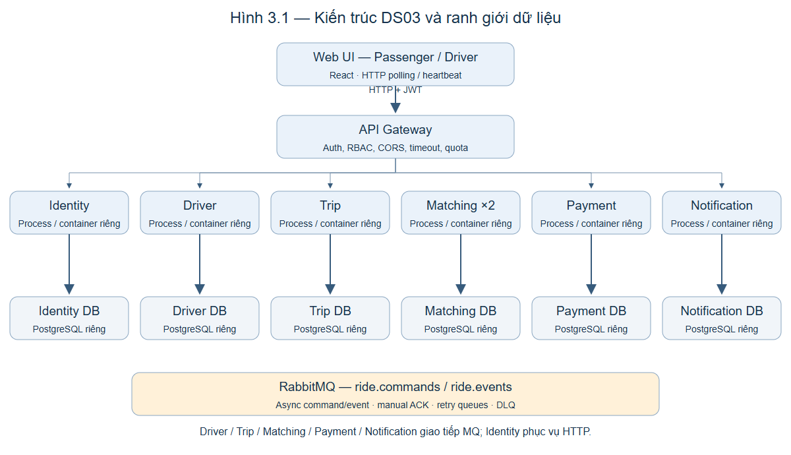
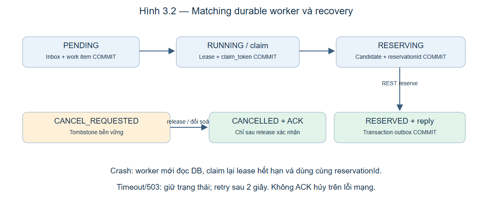
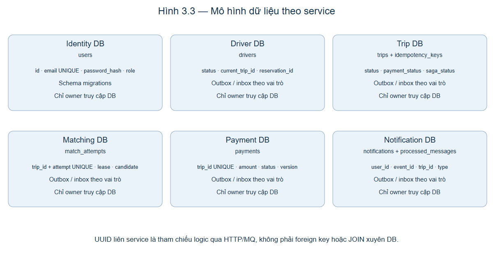
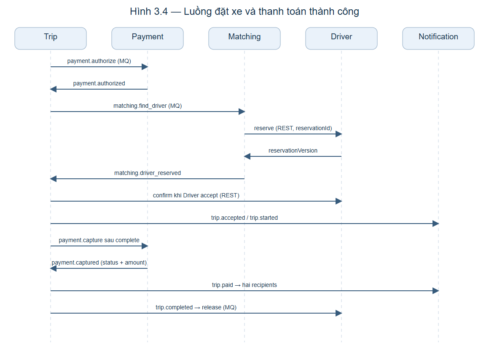
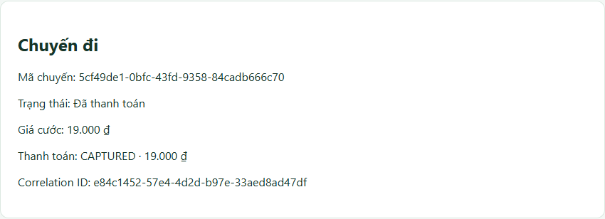
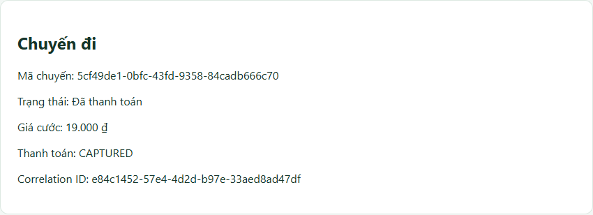

# BÁO CÁO BÀI TẬP LỚN

**MÔN HỌC: HỆ THỐNG PHÂN TÁN**

Trường: ................................................................................

Khoa: ..................................................................................

**ĐỀ TÀI DS03**

**XÂY DỰNG HỆ THỐNG ĐẶT XE MICROSERVICES MÔ PHỎNG GRAB/UBER**

Giảng viên hướng dẫn: ...........................................................

Lớp học phần: ................................ Nhóm bài tập: ........................

| STT | Họ và tên | Mã sinh viên | Vai trò trong đề tài |
|---|---|---|---|
| 1 | ................................ | ........................ | Platform, Identity, Gateway, Notification, UI, tích hợp |
| 2 | ................................ | ........................ | Trip, Saga, Payment, Pricing |
| 3 | ................................ | ........................ | Driver, Matching, Messaging, concurrency, hiệu năng |

Địa điểm: ................................ Năm 2026

---

# LỜI CẢM ƠN

Nhóm xin cảm ơn giảng viên học phần Hệ thống phân tán đã cung cấp kiến thức và yêu cầu thực hành để nhóm xây dựng, kiểm tra và đánh giá một hệ thống nhiều dịch vụ. Quá trình thực hiện giúp nhóm tiếp cận các vấn đề không xuất hiện trong ứng dụng chỉ có một tiến trình: thông điệp lặp, phản hồi bị mất sau khi dữ liệu đã commit, tranh chấp tài nguyên và trạng thái chưa đồng bộ giữa các thành phần.

Báo cáo trình bày giải pháp DS03 cùng bằng chứng chạy thử được lưu trong repository. Các giới hạn chưa kiểm chứng được ghi rõ để phân biệt kết quả thực tế với định hướng phát triển. Nhóm chịu trách nhiệm về mã nguồn, số liệu và khả năng giải thích các cơ chế đã sử dụng.

# TÓM TẮT

Đề tài xây dựng một nguyên mẫu đặt xe theo kiến trúc microservices, gồm sáu dịch vụ nghiệp vụ: Identity, Driver, Trip, Matching, Payment và Notification. Mỗi dịch vụ chạy độc lập, quản lý cơ sở dữ liệu riêng và giao tiếp qua HTTP hoặc RabbitMQ. API Gateway cung cấp điểm truy cập cho giao diện Passenger/Driver; Gateway không được tính vào số dịch vụ nghiệp vụ tối thiểu.

Các chức năng chính gồm đăng ký/đăng nhập, cập nhật vị trí và trạng thái tài xế, tạo yêu cầu đặt xe, chọn tài xế, nhận/từ chối chuyến, bắt đầu/hoàn thành chuyến, tính cước, thanh toán giả lập và thông báo. Hệ thống sử dụng conditional update và reservation token để tránh gán đôi tài xế; Saga và các hành động bù trừ điều phối trạng thái giữa các dịch vụ. Outbox, inbox, ACK sau commit, bounded retry và DLQ hỗ trợ xử lý thông điệp ít nhất một lần nhưng hạn chế tác động lặp.

Báo cáo tổ chức thành sáu chương theo bố cục mẫu được cung cấp: tổng quan, cơ sở lý thuyết, phân tích–thiết kế, cài đặt–triển khai, kết quả–demo và kết luận. Nội dung chuyên môn, sơ đồ, giao thức và kết quả được viết cho DS03. Không sử dụng chức năng, công nghệ hoặc số liệu của hệ thống P2P trong báo cáo mẫu để mô tả sản phẩm này.

---

# MỤC LỤC

[TOC]

# DANH MỤC TỪ VIẾT TẮT

| Từ viết tắt | Diễn giải | Vai trò trong dự án |
|---|---|---|
| API | Application Programming Interface | Giao diện HTTP của từng service |
| MQ | Message Queue | Truyền command/event bất đồng bộ |
| ACK | Acknowledgement | Xác nhận xử lý thông điệp |
| DLQ | Dead-letter queue | Lưu thông điệp lỗi vĩnh viễn/hết retry |
| JWT | JSON Web Token | Xác thực người dùng và role |
| RBAC | Role-based access control | Phân quyền Passenger/Driver/Admin |
| CAS | Compare-and-swap | Cập nhật có điều kiện theo trạng thái/version |
| TTL | Time to live | Thời hạn reservation và retry queue |
| VU | Virtual user | Người dùng mô phỏng trong bài đo tải |

# DANH MỤC HÌNH VÀ BẢNG

Hình 3.1: Kiến trúc tổng thể và ranh giới dữ liệu. Hình 3.2: Matching durable worker và recovery. Hình 3.3: Dữ liệu theo service. Hình 3.4: Luồng đặt xe và thanh toán. Hình 5.1–5.2: Giao diện chuyến đi/thanh toán được chụp trong bài UI thật.

Các bảng chính: đối chiếu yêu cầu, phân công, lựa chọn kiến trúc, trạng thái Trip/Driver/Payment, quyền sở hữu dữ liệu, REST API, message envelope, routing MQ, failure model, môi trường, ma trận kiểm thử, số liệu hiệu năng và checklist giao nộp.

# CHƯƠNG I. TỔNG QUAN ĐỀ TÀI

## 1.1. Đặt vấn đề

Một yêu cầu đặt xe liên quan đồng thời tới tài khoản hành khách, vị trí tài xế, giữ chỗ, trạng thái chuyến, thanh toán và thông báo. Nếu mọi thành phần nằm trong một tiến trình và một transaction DB, việc đồng bộ tương đối đơn giản nhưng không thể hiện các vấn đề của môn Hệ thống phân tán. Khi tách thành các service độc lập, lỗi mạng hoặc lỗi xử lý ở một service có thể khiến các service khác đã commit một phần nghiệp vụ.

Ví dụ, Driver có thể đã xác nhận reservation nhưng phản hồi HTTP không tới Trip. Nếu Trip xóa reservation rồi tìm tài xế mới, Driver cũ vẫn bận mà Trip không còn thông tin để giải phóng. Tương tự, việc broker xác nhận một publish không đồng nghĩa consumer đã hoàn tất xử lý; consumer có thể crash sau commit nhưng trước ACK và nhận lại cùng thông điệp. Các tình huống này là trọng tâm của đề tài.

Nguyên mẫu không kết nối ngân hàng hoặc bản đồ định tuyến thương mại. Vị trí được mô phỏng bằng tọa độ; khoảng cách và cước được tính bằng công thức đơn giản để tập trung vào communication, concurrency, consistency và recovery.

## 1.2. Mục tiêu

Mục tiêu chức năng là tái hiện trọn luồng Passenger đặt xe, Matching chọn Driver, Driver nhận/hoàn thành chuyến, Payment xử lý giả lập và Notification gửi kết quả cho hai bên. Mục tiêu kỹ thuật là chạy nhiều process độc lập, không đọc chéo dữ liệu service và duy trì các bất biến khi có cạnh tranh hoặc sự cố được lựa chọn.

Nhóm cần chứng minh không gán một tài xế cho hai chuyến đồng thời; một hành khách không có hai chuyến active; event trùng không tạo tác động nghiệp vụ lặp; Trip chỉ PAID khi Payment xác nhận CAPTURED đúng số tiền; và cancellation không được công nhận xong trước khi các bước bù trừ cần thiết được xác nhận.

## 1.3. Phạm vi và yêu cầu Course Project

| Nhóm yêu cầu | Nội dung bắt buộc | Cách đáp ứng trong DS03 |
|---|---|---|
| §4.1, §7.2 | Ít nhất ba process, ít nhất bốn business services | Sáu business services, containers và DB riêng |
| §4.2, §7.3 | Network communication, naming, message format | Docker DNS, REST/JSON, AMQP envelope và routing |
| §7.3 chức năng | Auth/role, location/status, booking/matching, accept/reject, lifecycle, fare/payment, notifications | API/UI và command/event tương ứng |
| §4.3 | Concurrency và mô hình nhất quán | Conditional reserve, booking lock, inbox/version/reservation fencing |
| §4.4 | Ít nhất hai failure/recovery scenarios | Retry/reconnect, Payment restart, Driver release lỗi, Matching replay |
| §4.5 | Auth, access control, validation, password hash, env, size limit | JWT, internal token fail-closed, Zod, bcrypt, HTTP/MQ limits |
| §9 | 8 functional, 2 concurrency, 2 fault/recovery, 2 security/invalid, 1 performance | Ma trận test và evidence ở Chương V |
| §10–11 | README, source/deploy/tests/scripts/docs, report, đóng góp, demo | Repository, Word/PDF và checklist giao nộp |

API Gateway, outbox, hai Matching instances và sơ đồ geospatial đơn giản là lựa chọn của nhóm. Không coi các lựa chọn này là thuật toán giảng viên bắt buộc; yêu cầu cốt lõi vẫn là các chức năng và cơ chế được nêu trong Course Project. TLS, tracing tập trung và scaling nâng cao chưa phải điều kiện thay thế cho phần cơ bản.

## 1.4. Phương pháp và phân công

Quy trình thực hiện gồm phân rã domain, thống nhất contract, xây schema riêng, triển khai REST trước các nhánh bất đồng bộ, bổ sung invariant/recovery rồi kiểm tra bằng DB/MQ và browser thật. Mỗi kết quả có command, môi trường, commit/working tree và expected/actual. Unit tests phục vụ logic hồi quy; integration và E2E kiểm tra các ranh giới mạng/dữ liệu.

| Vai trò | Module chính | Kiểm thử và tài liệu |
|---|---|---|
| TV1 | Platform, Identity, Gateway, Notification, UI | Auth/transport, integration/UI, E2E/demo, tổng hợp evidence/báo cáo |
| TV2 | Trip, Saga, Payment, Pricing | Lifecycle, capture/void, compensation, trạng thái DB |
| TV3 | Driver, Matching, common messaging | Reserve/lease/recovery, concurrency và performance |

Các lỗi tích hợp được sửa trên module liên quan theo yêu cầu chạy thử. Việc tổng hợp báo cáo không thay thế bằng chứng đóng góp Git hoặc nghĩa vụ từng thành viên giải thích phần mình. Họ tên/MSSV và thông tin lớp để trống theo yêu cầu, cần điền trước giao nộp.

# CHƯƠNG II. CƠ SỞ LÝ THUYẾT

## 2.1. Microservices và ranh giới dữ liệu

Microservices chia hệ thống theo năng lực nghiệp vụ, với process và dữ liệu do từng service quản lý. Một service không được sửa trực tiếp bảng thuộc service khác. Thông tin liên miền như passengerId hoặc tripId là tham chiếu logic; tính đúng đắn xuyên miền được duy trì qua API/event và bù trừ, không dựa vào foreign key xuyên database.

| Tiêu chí | Một ứng dụng/DB dùng chung | Thiết kế DS03 |
|---|---|---|
| Triển khai | Một đơn vị lớn | Service/container có entrypoint riêng |
| Transaction | Có thể bao trùm toàn bộ bảng | Local transaction; Saga giữa services |
| Communication | Gọi hàm trong process | HTTP và RabbitMQ |
| Failure | Lỗi process ảnh hưởng toàn ứng dụng | Có thể lỗi một phần; cần timeout/retry/recovery |
| Nhất quán | Local ACID dễ quan sát hơn | Strong local invariants, eventual cross-service state |
| Độ phức tạp | Vận hành ban đầu đơn giản | Cần quản lý contract, message, log và phiên bản |

Thiết kế phân tán không tự loại bỏ điểm lỗi đơn. Trong bản triển khai hiện tại, Gateway, broker và mỗi PostgreSQL vẫn có thể là điểm nghẽn hoặc điểm lỗi. Báo cáo phân biệt tính độc lập process với tính sẵn sàng cao.

## 2.2. REST và giao tiếp đồng bộ

REST qua HTTP phù hợp với đăng nhập, đọc trạng thái, thao tác UI và các lệnh reserve/confirm/release cần phản hồi trực tiếp. Request mang JSON và JWT/internal token. Response lỗi có code, message và correlationId. Timeout ngăn client/service chờ vô hạn nhưng không xác định được server đã commit hay chưa.

Đối với POST tạo chuyến, retry mù có thể tạo hai booking. Client gửi Idempotency-Key và cùng body khi thử lại. Server khóa quyết định theo passenger trong DB, so request hash và trả lại trip cũ nếu key/body trùng. Body khác với key đã dùng bị từ chối. Gateway không tự retry POST sau timeout upstream.

## 2.3. RabbitMQ và giao tiếp bất đồng bộ

Command yêu cầu một hành động cụ thể như payment.capture; event mô tả một việc đã xảy ra như trip.paid. Direct exchange định tuyến theo routing key chính xác; topic exchange cho phép subscription trip.* hoặc driver.*. Queue durable và message persistent phục vụ phục hồi broker, trong phạm vi cấu hình lưu trữ được chọn.

Delivery semantics hướng tới at-least-once: một message có thể được nhận lại. Publisher confirms xác nhận broker tiếp nhận publish; manual ACK xác nhận consumer đã hoàn tất trách nhiệm xử lý. Hai xác nhận này không thay thế nhau. Với message không route tới queue nào, không được suy ra nghiệp vụ đã thành công chỉ vì outbox được đánh dấu SENT [4].

## 2.4. Outbox, inbox và tác động idempotent

Local transaction ghi thay đổi nghiệp vụ và outbox cùng lúc. Poller chọn outbox PENDING bằng FOR UPDATE SKIP LOCKED, publish có confirms và cập nhật SENT. Nếu crash sau publish nhưng trước cập nhật SENT, lần phát lại có cùng eventId. Consumer insert eventId vào inbox trong transaction; chỉ lần insert đầu tiên mới chạy handler.

Inbox không đồng nghĩa mọi business command đều tự idempotent. Một command mới có eventId khác vẫn phải kiểm tra trip_id, trạng thái hoặc reservationId. Payment dùng trip_id unique và state machine; Driver đối chiếu current_trip_id/reservation_id/version. Notification có unique constraint theo recipient/event/type để không hiển thị lặp.

## 2.5. Saga và giao dịch bù trừ

Saga là chuỗi local transactions với trạng thái điều phối được lưu bền. DS03 chọn Trip làm orchestrator: authorize thanh toán, tìm/giữ Driver, nhận và thực hiện chuyến, capture sau complete. Trước pivot bắt đầu chuyến, cancel hoặc lỗi có thể yêu cầu matching.cancel_attempt, driver.release và payment.void.

Compensation không phải rollback nguyên tử toàn hệ thống. Các hành động có thể đến muộn, trùng hoặc gặp lỗi kỹ thuật. Trip duy trì COMPENSATING, theo dõi ACK đúng attempt/reservation và chỉ chuyển CANCELLED khi điều kiện hoàn tất được thỏa mãn. Reconciler phát lại bước chưa được xác nhận qua outbox; không ép trạng thái bằng cách sửa DB cho đẹp kết quả.

## 2.6. Đồng thời, lease và fencing

Conditional update giữ bất biến tại DB owner: reserve chỉ thắng khi Driver AVAILABLE. Hai Matching instances cùng tranh một Driver vẫn có tối đa một update thắng. Claim token và lease giúp phân công durable work trong Matching; instance khác có thể tiếp tục khi lease hết hạn.

Lease hết hạn không chứng minh công việc trước đó chưa tạo tác động. Vì vậy candidate_driver_id và reservation_id phải commit trước REST reserve; khi replay, worker sử dụng cùng reservationId. Reservation version và UUID giúp phát hiện confirm/release cũ. Sau khi receive ACK, Trip vẫn kiểm tra identity của bước Saga, thay vì công nhận mọi message cùng tên.

## 2.7. Nhất quán và phát hiện offline

Mô hình được chọn là nhất quán mạnh tại từng aggregate khi quyết định cạnh tranh được đưa vào transaction/conditional update, và eventual consistency giữa services. Sau complete, Trip có thể tạm COMPLETED/CAPTURE_PENDING trước khi Payment trả kết quả và Notification cập nhật. UI phải thể hiện trạng thái chờ thay vì tự suy ra đã thanh toán.

Driver gửi location heartbeat năm giây. Job offline xét last_seen_at của Driver AVAILABLE; không tự đổi RESERVED/ON_TRIP thành AVAILABLE chỉ vì UI tạm mất kết nối. Reservation có deadline và TTL job giải phóng khi hết hạn, đồng thời ghi event chứa trip/reservation cũ để Trip xử lý tiếp.

## 2.8. Xác thực, phân quyền và giới hạn tài nguyên

JWT xác định userId và role; Gateway kiểm tra quyền route và service kiểm tra ownership. Internal token phục vụ lời gọi giữa services, được đọc từ env và từ chối truy cập nếu cấu hình thiếu. Password được hash bằng bcrypt; không lưu mật khẩu rõ trong bảng users.

Rate limit auth giữ theo IP để hạn chế login abuse. API đã xác thực và booking được chia quota theo userId đã verify, tránh nhiều người chung NAT cùng tiêu hết một quota polling. HTTP/MQ body limits, schema validation, bounded retry và DLQ hạn chế tải lỗi. TLS là giới hạn chưa triển khai cho demo local, không mô tả HTTP hiện tại như cấu hình public an toàn.

# CHƯƠNG III. PHÂN TÍCH VÀ THIẾT KẾ HỆ THỐNG

## 3.1. Kiến trúc tổng quan



Browser truy cập Gateway; Gateway chuyển REST tới service owner. Matching không được expose trực tiếp ra UI. Trip điều phối command/reply; Driver quản lý tài nguyên tài xế; Payment lưu trạng thái tiền giả lập; Notification nhận sự kiện và cung cấp inbox cho UI. Hai Matching containers chia sẻ DB của cùng logical service, không phải đọc chéo DB của một domain khác.

Tên service trong Compose là địa chỉ discovery. SERVICE_NAME/INSTANCE_ID xuất hiện trong log/envelope để phân biệt node. Database, broker và backend nằm trong Docker network; các process giao tiếp qua socket mạng thay vì file hoặc biến toàn cục dùng chung.

## 3.2. Các use case và quyền truy cập

| Actor | Use case | Ràng buộc |
|---|---|---|
| Passenger | Register/login, đặt/xem/hủy chuyến, xem payment và notifications | Chỉ tài nguyên thuộc userId; không gọi Driver command |
| Driver | Register/login, online/offline, location, offer, accept/reject/start/complete | Chỉ chuyến được gán; không tự chuyển AVAILABLE khi đang bận |
| Service nội bộ | Discovery/reserve/confirm/release, payment reconciliation | Token nội bộ, validation và reservation identity |
| Người demo | Start/stop/restart, xem log/evidence | Chỉ thao tác project local đã cấu hình; không đưa secret vào báo cáo |

Hai trường hợp cạnh tranh tiêu biểu là hai Passenger tranh một Driver và một Passenger gửi nhiều booking đồng thời. Trường hợp lỗi tiêu biểu gồm consumer/DB lỗi, broker restart, Payment dừng giữa complete/capture, Driver trả 503 khi release và phản hồi confirm bị mất sau commit.

## 3.3. Thiết kế dịch vụ

### 3.3.1. Identity và Gateway

Identity chịu trách nhiệm users, register/login/me và ký JWT có issuer ds03, audience ride, role và expiry 15 phút. Public registration không cho tự cấp ADMIN. Gateway kiểm tra JWT, route allowlist và role, giới hạn body, CORS, quota và upstream timeout; các header giả danh x-user-* hoặc x-internal-token từ client bị loại bỏ.

Gateway không trở thành nguồn dữ liệu nghiệp vụ. Quyết định ownership của Trip/Payment/Notification vẫn nằm tại owner service. Quota API theo verified userId không cho phép client tự khai userId qua header; các request public hoặc chưa xác thực dùng IP.

### 3.3.2. Driver

Driver lưu trạng thái, vị trí, last_seen_at, current_trip_id, reservation_id/version và deadline. Reserve là conditional update khi AVAILABLE; lặp cùng reservation được xử lý idempotent. Confirm kiểm tra trip/reservation/version và thời hạn trước chuyển ON_TRIP. Release đúng reservation đưa về AVAILABLE; release cũ không được làm rơi reservation mới.

API online/offline cũng kiểm tra nguyên tử trong UPSERT: trạng thái hiện tại phải AVAILABLE/OFFLINE, current_trip_id và reservation_id đều null. SELECT trước đó chỉ là kiểm tra nhanh/log snapshot, không quyết định tính an toàn. Vì vậy, khi reserve hoặc confirm xen giữa SELECT và UPSERT, API status trả 409 và không ghi đè RESERVED/ON_TRIP. Bốn bài regression dùng PostgreSQL thật kiểm tra chính các lịch thực thi này.

| Trạng thái Driver | Ý nghĩa | Chuyển trạng thái chính |
|---|---|---|
| OFFLINE | Không nhận chuyến | Chủ động online → AVAILABLE |
| AVAILABLE | Có thể được reserve, heartbeat còn hạn | Reserve → RESERVED; chủ động offline/timeout → OFFLINE |
| RESERVED | Giữ cho một trip trong thời hạn | Confirm → ON_TRIP; release/expiry → AVAILABLE |
| ON_TRIP | Đã nhận và phục vụ chuyến | Complete hoặc compensation hợp lệ → AVAILABLE |

### 3.3.3. Matching và durable worker

Consumer lưu match_attempts PENDING hoặc tombstone CANCEL_REQUESTED cùng transaction inbox. Consumer không thực hiện network request trong transaction đánh dấu message đã xử lý. Worker riêng claim công việc, commit candidate/reservation trước HTTP và lưu reply cùng outbox khi có kết quả.



Khi crash, công việc PENDING còn trong DB hoặc lease RUNNING/RESERVING hết hạn sẽ được worker khác claim. Nếu đã có reservation_id, worker replay cùng ID, nhờ Driver reserve idempotent. Lỗi discovery/reserve kỹ thuật giữ công việc để retry, không được biến thành kết luận không có tài xế. Cancellation chỉ phát matching.attempt_cancelled sau khi release được xác nhận; timeout/503 giữ CANCEL_REQUESTED.

### 3.3.4. Trip và Saga

Trip lưu tọa độ, fare, actor IDs, reservation tokens, match attempt, trạng thái chuyến/thanh toán/Saga, các ACK bù trừ và correlation. Booking dùng advisory lock theo Passenger để serialize cả trường hợp key chưa có row; unique active-trip là hàng rào DB bổ sung.

| Trạng thái Trip | Điều kiện/ý nghĩa |
|---|---|
| REQUESTED | Đã lưu booking và lệnh authorize |
| SEARCHING | Payment authorized, chờ Matching |
| DRIVER_ASSIGNED | Có reservation và offer deadline |
| ACCEPTING | Đã claim accept, chờ kết quả confirm Driver |
| ACCEPTED | Driver xác nhận thành công |
| IN_PROGRESS | Driver bắt đầu chuyến; không hủy như pre-pivot |
| COMPLETED | Đã tới nơi, chờ capture |
| PAID | Nhận capture thành công đúng status/amount |
| COMPENSATING | Còn bước cancel/release/void cần hoàn tất |
| CANCELLED | Các điều kiện bù trừ đã được xác nhận |

Nếu confirm timeout/503, Trip giữ driver/reservation identity và chuyển COMPENSATING. Điều này xử lý cả tình huống Driver đã ON_TRIP nhưng phản hồi không tới Trip. ACK cancel/release được so theo matchAttempt/reservation, tránh message cũ xác nhận nhầm bước mới.

### 3.3.5. Pricing và Payment

Pricing nằm trong Trip. Khoảng cách Haversine dùng bán kính Trái Đất 6.371 km; cước là max(12.000, round((12.000 + 10.000 × distanceKm)/1.000) × 1.000) VND. Đây là khoảng cách mô phỏng, không phải chiều dài đường bộ hoặc giá Grab/Uber thực tế. Fare được lưu bằng integer và được giữ cho authorize/capture.

Payment lưu một record theo trip_id. Authorize tạo AUTHORIZED hoặc DECLINED; void trước authorize tạo tombstone để authorize đến muộn không phục hồi khoản giữ. Capture chỉ thành công khi state cho phép và số tiền khớp. Capture trên NOT_FOUND/VOIDED/TOMBSTONED hoặc amount mismatch phát capture_rejected, không phát payment.captured. Void khoản đã CAPTURED không trả payment.voided giả; refund hậu thanh toán nằm ngoài phạm vi hiện tại.

### 3.3.6. Notification và Web UI

Notification nhận trip.requested/accepted/started/completed/cancelled/paid. Trong local transaction, service insert inbox và notification cho tập recipients không trùng. ACK sau COMMIT. GET /notifications/me lọc theo JWT userId, trả tối đa 200 bản ghi gần nhất; since dựa thời điểm nhận/lưu.

UI Passenger tạo/xem/hủy chuyến, UI Driver gửi heartbeat, xem offer và thực hiện lifecycle. Polling hai giây đọc trạng thái backend; heartbeat location năm giây không thay availability. UI hiển thị tripId, correlationId, fare và payment, phân biệt chờ thanh toán với đã CAPTURED. Phiên hết hạn quay về login; sai mật khẩu không bị báo nhầm là phiên hết hạn.

## 3.4. Thiết kế cơ sở dữ liệu



| DB owner | Bảng | Thuộc tính/ràng buộc chính |
|---|---|---|
| Identity | users | id UUID, email unique, password_hash, role, name |
| Driver | drivers | status, location, current_trip_id, reservation_id/version, reserved_until, last_seen_at |
| Trip | trips | Actor IDs, coordinates, integer fare, status/payment/Saga, attempts, ACK flags, version |
| Trip | idempotency_keys | Primary key user_id + key, request_hash, trip_id |
| Matching | match_attempts | Unique trip_id + attempt, durable status, candidate, reservation, claim token/lease |
| Payment | payments | trip_id primary key, passenger_id, integer amount, status, version |
| Notification | notifications | Recipient/event/type unique, trip_id, version, correlation, created_at |
| Các owner có MQ | processed_messages | event_id primary key cho inbox |
| Các producer | outbox | event_id unique, exchange/routing, envelope, PENDING/SENT, retry metadata |
| Mỗi service | schema_migrations | Version theo tên SQL, applied_at |

Không có foreign key hoặc JOIN runtime giữa các DB. Một trip_id trong Notification không cho phép Notification ghi bảng trips. Các truy vấn kiểm chứng DB nằm trong test harness hoặc công cụ của owner, không nằm trong luồng nghiệp vụ service khác.

Migration chạy trong transaction với advisory lock. Chỉ thêm file migration mới khi thay schema; không sửa file đã áp dụng trên dữ liệu đang dùng. Helper đọc directory URL an toàn với cả trường hợp có/không slash cuối, có regression test riêng.

## 3.5. REST API và quy ước lỗi

| API | Chủ thể | Kết quả/chức năng |
|---|---|---|
| POST /auth/register, /auth/login | Public | Tạo user hoặc cấp JWT |
| GET /users/me | Authenticated | User theo token |
| GET /drivers/me | Driver | Profile hoặc tự khởi tạo idempotent |
| PUT /drivers/me/status, /location | Driver | Online/offline hoặc heartbeat/location |
| POST /trips | Passenger | Booking với Idempotency-Key |
| GET /trips/me/active, /trips/:id | Owner | Chuyến active hoặc chi tiết có ownership |
| GET /trips/offers | Driver | Offer còn hạn của Driver |
| POST /trips/:id/accept,reject,start,complete,cancel | Theo role/owner | Chuyển trạng thái hợp lệ |
| GET /payments/:tripId | Passenger owner/Admin | Trạng thái/số tiền |
| GET /notifications/me | Authenticated | Inbox của chính user |
| /internal/drivers/*, /internal/matching/*, /internal/payments/* | Internal token | Reserve/release/reconcile và trạng thái nội bộ |

Lỗi JSON gồm code, message và correlationId. Các mã HTTP chính là 400 cho dữ liệu không hợp lệ, 401 cho token thiếu/sai/hết hạn, 403 cho quyền không phù hợp, 404 cho tài nguyên không được truy cập, 409 cho xung đột trạng thái, 422 cho tái dùng idempotency key với body khác, 429 cho quota và 503 cho dependency không sẵn sàng. Internal token thiếu cấu hình cũng trả lỗi, không bỏ qua xác thực.

## 3.6. Message envelope và routing

| Trường | Kiểu | Mục đích |
|---|---|---|
| eventId | UUID | Deduplication |
| type, schemaVersion | String, integer | Chọn handler và phiên bản schema |
| occurredAt | ISO timestamp | Thời điểm tạo envelope |
| producer | Service + instanceId | Truy nguồn node |
| correlationId, causationId | UUID, UUID/null | Liên kết một nghiệp vụ và nguyên nhân |
| aggregateId, aggregateVersion | UUID, integer | Tài nguyên và phiên bản |
| matchAttempt | Integer | Phân biệt lượt Matching |
| payload | Object | Dữ liệu command/event theo contract |

| Exchange/routing key | Queue | Consumer |
|---|---|---|
| ride.commands: payment.authorize/capture/void | payment.commands | Payment |
| ride.commands: matching.find_driver/cancel_attempt | matching.commands | Matching inbox/work item |
| ride.commands: driver.release | driver.commands | Driver |
| ride.commands: trip.replies | trip.replies | Trip orchestrator |
| ride.events: driver.* | trip.driver-events | Trip |
| ride.events: trip.* | driver.trip-events | Driver cleanup |
| ride.events: trip.* | notification.events | Notification |
| ride.retry và các queue TTL | Queue gốc sau delay | Consumer tương ứng |
| ride.dlq | <queue>.dlq | Lưu lỗi để xem xét/replay có kiểm soát |

matching.find_driver dùng excludedDriverIds. Payload của notification phải có tripId/passengerId và driverId khi đã gán. Trip chỉ chấp nhận payment.captured khi payload.status là CAPTURED và amount bằng quoted_fare; tên event đơn lẻ không đủ chứng minh thanh toán thành công.

## 3.7. Luồng nghiệp vụ và bù trừ



Booking lưu REQUESTED và outbox authorize. Payment reply authorized đưa Trip sang SEARCHING, phát find_driver. Matching durable worker chọn và reserve Driver; reply mang driverId/reservationId/version. Khi Driver accept, Trip chuyển ACCEPTING rồi confirm qua REST. Sau ACCEPTED, Driver start đưa IN_PROGRESS; complete ghi COMPLETED/CAPTURE_PENDING và outbox capture. Reply thành công hợp lệ đưa PAID, phát trip.paid cho hai recipients.

Cancel pre-pivot chuyển COMPENSATING. Trip yêu cầu Matching dừng attempt, Driver giải phóng reservation nếu đã biết và Payment void. Missing ACK được retry qua reconciler với khoảng lùi, giữ thông tin token. Matching có tombstone chặn find đến muộn. Message authorize/reserve đến muộn của chuyến đang hủy được chuyển sang void/release thay vì phục hồi chuyến.

## 3.8. Bất biến và kiểm soát cạnh tranh

| Bất biến | Cơ chế | Kiểm chứng |
|---|---|---|
| Một Driver tối đa một reservation/trip hiện hành | Conditional reserve tại Driver DB | C01, Driver tests |
| Một Passenger tối đa một trip active | Advisory lock quyết định booking + unique index | C02 |
| Cùng key/body trả cùng trip | Idempotency table + request hash | Trip tests; cần phân biệt với C02 dùng key khác |
| Event trùng không tạo tác động lặp | Inbox insert trong transaction | Unit/integration MQ |
| Chỉ PAID sau capture hợp lệ | Guard trạng thái và amount | Recovery integration |
| Hủy không xong trước release xác nhận | Durable CANCEL_REQUESTED + worker retry | Release 503/recovery test |
| ACK cũ không hoàn tất bước Saga mới | So attempt/reservation | Guards và test tương ứng |

C01 dùng hai Passenger, một Driver; trạng thái cuối phải có đúng một winner, loser đã CANCELLED và Driver trỏ đúng winner trước cleanup. C02 dùng một Passenger gửi mười yêu cầu khác key; đúng một thành công, chín request còn lại phải 409, không chấp nhận 500/timeouts hoặc tất cả thất bại như một kết quả PASS.

## 3.9. Failure model, recovery và giới hạn

| Sự cố | Phát hiện | Xử lý và trạng thái cần giữ |
|---|---|---|
| HTTP upstream không đáp ứng | Timeout | 503/409 phù hợp, giữ identity cho reconcile |
| Message trùng hoặc consumer restart | eventId/inbox | Không tạo tác động lặp; ACK sau commit |
| DB handler lỗi | Transaction rollback | Retry hữu hạn, rồi DLQ |
| Broker restart | Connection manager | Reconnect, queue durable, outbox pending tiếp tục |
| Payment down sau complete | CAPTURE_PENDING | Queue giữ command; restart xử lý capture |
| Driver release trả 503 | HTTP status/exception | Matching giữ CANCEL_REQUESTED, không phát ACK hủy |
| Matching crash sau persist candidate | Lease hết hạn | Worker dùng cùng reservationId rồi phát reply |
| Confirm commit nhưng phản hồi mất | Kết quả HTTP không chắc chắn | Trip COMPENSATING, giữ Driver/reservation, phát release |
| Reservation hết hạn | reserved_until | Release và event chứa trip/reservation cũ |

Không cam kết chịu mọi partition kéo dài, lỗi đồng thời nhiều DB hoặc HA broker. Reconciliation có thể tiếp tục chờ nếu dependency không phục hồi. Đây là lựa chọn nhất quán ưu tiên trạng thái trung thực hơn việc thông báo thành công sớm.

# CHƯƠNG IV. CÀI ĐẶT VÀ TRIỂN KHAI

## 4.1. Công nghệ và cấu trúc mã nguồn

| Công nghệ | Vai trò |
|---|---|
| Node.js 24, TypeScript | Backend độc lập và tools |
| Fastify và plugins | HTTP, JWT, CORS, proxy, rate limit |
| PostgreSQL 16 | Local ACID, constraints, advisory/row locks |
| RabbitMQ 4.1, amqplib/connection manager | AMQP, confirms, ACK/retry/reconnect |
| React và Vite | Web UI |
| Vitest, Playwright/Edge | Unit/integration/browser |
| Docker Compose | Network, DB/service process, healthcheck/restart |
| Python standard library | Xuất Word và bản HTML để in PDF |

Phiên bản package chính xác được khóa trong package-lock.json. Mỗi service có package.json, entrypoint và migrations riêng; common chứa helper nền tảng, không phải một DB hoặc bộ biến nghiệp vụ dùng chung.

```text
src/common/                  messaging, auth, migration, platform helpers
src/services/identity-service/
src/services/api-gateway/
src/services/driver-service/
src/services/trip-service/
src/services/matching-service/
src/services/payment-service/
src/services/notification-service/
src/web-ui/                  React Passenger/Driver
deploy/                      Dockerfiles, Compose test
tests/                       unit, integration, concurrency, e2e
scripts/                     startup, seed, demo, benchmark, report
docs/                        TV1, contracts, report, figures, evidence
```

## 4.2. Môi trường, secrets và cơ sở dữ liệu

| Biến/nhóm biến | Mục đích | Cách cấu hình |
|---|---|---|
| JWT_SECRET | Ký/verify user token | Đồng nhất giữa services, đủ dài, env |
| INTERNAL_TOKEN | Xác thực REST nội bộ | Đồng nhất, bắt buộc, không fallback công khai |
| *_DB_PASSWORD | Password DB từng owner | Sinh ngẫu nhiên, không đưa vào báo cáo |
| DATABASE_URL | DB của chính service | Compose truyền theo owner |
| RABBITMQ_PASSWORD/RABBITMQ_URL | Kết nối MQ | Secrets từ env |
| SERVICE_NAME/INSTANCE_ID/PORT | Định danh và cổng container | Compose |
| UI_ORIGIN, *_URL | CORS và upstream discovery | Local defaults hoặc env override |

Startup tạo .env khi chưa có, bổ sung key thiếu và giữ credentials cũ. Biến đã khai báo nhưng rỗng cần sửa rõ ràng, không tạo duplicate key. Không commit .env, token hoặc logs chứa credentials. Các tài khoản demo dùng mật khẩu công khai chỉ phục vụ local, không dùng làm tài khoản triển khai public.

Docker DB production không mở host port. Compose test riêng dùng *_test databases và cổng 55431–55436, RabbitMQ 5673. Fixture/test truncation chỉ được thực hiện trên DB test, không dùng để dọn production. Mỗi bài đọc current_database để kiểm tra guard.

## 4.3. Cài đặt và khởi chạy

```powershell
npm.cmd ci
npm.cmd run up
```

Node.js 24 và Docker Desktop Linux containers phải hoạt động. Startup build image, chạy migrations, đợi healthchecks rồi seed hai Passenger và một Driver qua HTTP. Healthcheck RabbitMQ kiểm tra AMQP listener thay vì chỉ Erlang ping. UI ở http://localhost:3000, Gateway ở http://localhost:8080; Management ở localhost:15672.

```powershell
docker compose ps
npm.cmd run smoke
npm.cmd run e2e -- E01
npm.cmd run e2e -- E02
npm.cmd run e2e -- E03
npm.cmd run e2e -- E04
```

Các bài sử dụng tài khoản seed nên chạy tuần tự. E03 kill/restart Payment thật và có finally khôi phục service nếu test lỗi. Test chạm 429 tôn trọng Retry-After, không tăng quota hoặc mock response để công nhận PASS.

## 4.4. Kiểm thử độc lập và bằng chứng

```powershell
npm.cmd run typecheck
npm.cmd run build
npm.cmd test
docker compose -f deploy/compose.test.yaml up -d --wait
npm.cmd run test:integration
npm.cmd run test:ui
npm.cmd run test:ui:business
npm.cmd run test:concurrency
npm.cmd run benchmark
npm.cmd run verify:tv1 -- --full
```

UI fixture dùng cổng riêng 3001/8088 và DB/MQ test; không thay producer Trip thật. UI-BUSINESS dùng deployment 3000/8080 với hai browser contexts và không intercept nghiệp vụ. Integration chạy tuần tự do có bài restart RabbitMQ test. Không chạy thao tác tay xen vào test dùng chung tài khoản.

Artifacts thô ở artifacts/ bị gitignore. Runner lưu bản được chọn vào docs/evidence/tv1/<thời gian>/, che secrets và ghi results.json có môi trường, command, expected/actual, status, log và commit/working tree. latest.json chỉ trỏ lượt gần nhất; một lượt PASS không chứng minh các lượt trước hoặc mọi test ngoài phạm vi đã PASS.

## 4.5. Vận hành và redeploy

Mỗi container/service có thể stop/restart độc lập. scripts/logs-by-trip.ps1 hỗ trợ correlation log theo chuyến. scripts/reset-demo.ps1 xóa volumes project ds03, chỉ dùng khi dữ liệu demo được phép bỏ; việc reset không phải cơ chế recovery nghiệp vụ.

Redeploy máy sạch cần clone source/checkout commit, không chép .env/node_modules/volumes, chạy npm ci/up và bộ kiểm tra, rồi lưu evidence của môi trường đó. Startup thành công trên máy phát triển không tự chứng minh redeploy máy sạch. Checklist đăng ký nhóm, quyền giảng viên nếu repo private, commit từng thành viên và final tag/release vẫn cần xác nhận trước nộp.

## 4.6. Xuất và chỉnh sửa báo cáo

docs/report.md là nguồn nội dung. npm run report:word tạo DOCX có headings, bảng, mục lục Word cập nhật được và hình nhúng. npm run report:pdf tạo PDF từ cùng nội dung. Bản Word có thể sửa trực tiếp; xuất lại từ Markdown sẽ ghi đè DOCX, vì vậy giữ bản Word đã chỉnh hoặc cập nhật nguồn trước khi xuất.

Thông tin hành chính trên bìa được để trống theo yêu cầu. Bố cục sáu chương lấy từ file mẫu Markdown; không sao chép tên người, lớp, giảng viên, công nghệ hoặc số liệu P2P. Hình kiến trúc/Saga/dữ liệu do nhóm dựng theo source DS03; ảnh UI đến từ lần chạy thật.

# CHƯƠNG V. KẾT QUẢ, KIỂM THỬ VÀ DEMO

## 5.1. Phương pháp đánh giá

Mỗi bài phải có trigger, expected, actual và điều kiện trạng thái cuối. Test DB/MQ thật phân biệt với mock HTTP/unit; fixture chỉ tạo điều kiện hoặc thông điệp thử, không thay nghiệp vụ thành công. Benchmark ghi cấu hình máy, số request, độ đồng thời, latency, throughput và lỗi; không dùng thời gian chờ auth để suy ra latency nghiệp vụ.

Unit/regression bảo vệ các lỗi đã sửa; integration kiểm tra transaction, queue, failures và ownership; E2E kiểm tra qua Gateway; browser test kiểm tra khả năng dùng UI thật. Các mức bổ sung nhau nhưng không thay thế cho bằng chứng đúng số loại kịch bản theo §9.

## 5.2. Ma trận chức năng và security

| ID | Kịch bản | Điều kiện đạt | Nguồn kiểm tra |
|---|---|---|---|
| F01 | Đăng ký đúng role, hash password | User tạo đúng, không lưu plaintext, không tự cấp ADMIN | Identity/unit/integration/UI |
| F02 | Login/me và token | Thông tin đúng; sai/expired token bị từ chối | Gateway/Identity tests |
| F03 | Driver location/status/heartbeat | Online và giữ last_seen, không làm rơi reservation | Driver tests, UI-BUSINESS |
| F04 | Booking/idempotency | Tạo trip, same key/body trả cũ, body khác bị từ chối | Trip tests, E01 |
| F05 | Matching/reserve | Chọn candidate phù hợp, lưu reservation/reply | E01, recovery tests |
| F06 | Accept/start/complete | Chuyển trạng thái theo actor và thứ tự | E01/UI-BUSINESS |
| F07 | Fare/capture | Fare integer; PAID chỉ sau CAPTURED đúng amount | Pricing, Payment/Trip recovery |
| F08 | Reject/rematch | Không chọn lại Driver đã từ chối; release sạch | E04 |
| F09 | Cancel/compensation | CANCELLED, Driver release, Payment VOIDED | E02 |
| F10 | Notifications hai bên | Đúng recipient, không lặp event | Integration/E01/E02/UI |
| S01 | Input/schema/size sai | 400/413 hoặc DLQ, không ghi dữ liệu sai | Unit/integration |
| S02 | Token thiếu/sai/hết hạn | 401, không lộ tài nguyên | Unit/smoke |
| S03 | Role/ownership/internal | 403/404; thiếu internal config fail-closed | Unit/recovery integration |

## 5.3. Concurrency và phục hồi

| ID | Sự kiện gây ra | Kiểm chứng |
|---|---|---|
| C01 | Hai Passenger đồng thời tranh một Driver | Đúng một winner, loser CANCELLED, Driver trỏ winner, cleanup qua API |
| C02 | Một Passenger gửi mười booking đồng thời | Một thành công, chín 409; không đếm lỗi kỹ thuật là PASS |
| X-DB | Notification DB handler lỗi | Inbox/notification rollback, retry rồi phục hồi |
| X-MQ | RabbitMQ test restart | Consumer reconnect, xử lý tiếp event |
| X-Payment | Kill Payment sau IN_PROGRESS | Complete giữ CAPTURE_PENDING; restart → CAPTURED/PAID |
| X-Release | Driver release 503 | Matching không ACK hủy; phục hồi dependency → release/ACK |
| X-Matching | Work PENDING/RESERVING còn trong DB, lease hết | Worker tiếp tục cùng reservation, phát reply |
| X-Confirm | Driver commit ON_TRIP nhưng phản hồi lỗi | Trip giữ tokens, COMPENSATING và phát release |
| X-Capture | Capture trước authorize/sau void hoặc event giả trạng thái/số tiền | Không phát success sai, Trip không PAID sai |

Các bài hồi quy có fault injection có kiểm soát được ghi là integration tests, không mô tả thành một thí nghiệm mạng diện rộng. E03 thực sự dừng/restart process Payment. C01/C02 cần xét điều kiện setup chỉ một Driver phù hợp và dữ liệu thử riêng để kết luận đúng.

## 5.4. Tổng hợp kết quả chạy

<!-- RESULTS_START -->
| Kiểm tra | Kết quả thực tế | Phạm vi |
|---|---|---|
| TYPECHECK | PASS | Kiểu dữ liệu backend, tools và UI |
| BUILD | PASS | Biên dịch TypeScript và UI production |
| UNIT | PASS; 44/44 tests | Logic và hồi quy cho các lỗi đã sửa |
| DOCKER | PASS | Docker Engine hoạt động |
| TEST-INFRA | PASS | DB/MQ test độc lập sẵn sàng |
| INTEGRATION-TV1 | PASS; 17/17 tests | DB/MQ thật: Notification, Payment/Trip, Matching recovery, internal auth, TTL |
| UI-TV1 | PASS; 9/9 checks | Auth/role/lỗi/Notification với fixture trên DB/MQ thật |
| STARTUP | PASS | Build/start/healthcheck/seed qua HTTP |
| SMOKE | PASS | Auth, me, notifications và quyền truy cập qua Gateway |
| E01 | PASS | Đặt xe, nhận và hoàn thành/thanh toán |
| E02 | PASS | Hủy, release Driver, void Payment, thông báo hai bên |
| E03 | PASS | Kill/restart Payment và xử lý tiếp command |
| E04 | PASS | Reject/rematch, không chọn lại Driver từ chối |
| UI-BUSINESS | PASS | Hai browser contexts, heartbeat và nghiệp vụ thật |
| CONCURRENCY | PASS | C01 + C02, gồm trạng thái cuối và cleanup |
| P01 | PASS | API đọc, không phải booking throughput |
| REDEPLOY | BLOCKED | Chưa chạy máy sạch; không suy ra từ startup local |

Thời điểm kết thúc: 2026-11-17T12:49:30.642Z (UTC). Tổng trạng thái: **BLOCKED**. Lượt: `docs/evidence/tv1/2026-11-17T12-42-08-385Z/results.json`.
BLOCKED do REDEPLOY nghĩa là chưa kiểm chứng máy sạch, không phải các bài local đang lỗi. Xem từng hàng để phân biệt PASS/FAIL/BLOCKED.
<!-- RESULTS_END -->

Bổ sung sau lượt full: race giữa Driver status và reserve/confirm đã được sửa. Typecheck và 44 unit tests PASS; integration tăng thành **21/21 PASS**, gồm bốn trường hợp AVAILABLE/OFFLINE cạnh tranh RESERVED/ON_TRIP. Bằng chứng tại docs/evidence/review-2026-11-17/driver-fix-integration.json. Audit trước/sau cho cùng lịch thực thi đổi từ 200/200/200 sang reserve A 200, status 409, reserve B 409; bản sửa giữ reservation đầu tiên. Các con số 17/17 trong bảng lượt full phía trên là lịch sử của lượt đó, không phải bộ regression mới.

Các failure lịch sử trước sửa lỗi được giữ để giải thích quá trình phát hiện, không dùng làm trạng thái hiện tại. Lượt mới ghi riêng commit/working tree vì code có thể chưa commit trong khi kiểm tra; không gán kết quả cho một release chưa tồn tại.

## 5.5. Giao diện và minh chứng

Giao diện Passenger hiển thị chuyến, giá, trạng thái thanh toán và correlationId. Giao diện Driver cho phép online, heartbeat, nhận/từ chối và điều khiển lifecycle theo trạng thái backend. Ảnh dưới đây được chụp từ hai phiên trình duyệt trong bài UI nghiệp vụ thật, không phải mockup.

<!-- UI_FIGURES_START -->



<!-- UI_FIGURES_END -->

## 5.6. Kịch bản demo bắt buộc

| Bước | Thao tác | Điều cần trình bày |
|---|---|---|
| 1 | Start services độc lập, docker compose ps | Process/network/DB riêng |
| 2 | Driver online và location heartbeat | AVAILABLE/last_seen và log |
| 3 | Passenger đặt xe | Idempotency-Key, tripId, correlation |
| 4 | Matching chọn/reserve | Candidate, reservation identity, command/reply |
| 5 | Driver accept/start/complete | Lifecycle và capture đúng tiền, notification hai bên |
| 6 | Chạy C01 | Hai Passenger đồng thời, một Driver không bị gán đôi |
| 7 | Kill Payment khi đang trong luồng | Process dừng thật |
| 8 | Complete trong lúc Payment down | Pending command/CAPTURE_PENDING, không PAID sớm |
| 9 | Restart Payment | Queue tiếp tục xử lý, CAPTURED/PAID và thông báo |

TV1 trình bày Platform/auth/UI và automation; TV3 giải thích reserve/Matching/concurrency; TV2 giải thích Trip/Saga/Payment/recovery. Tất cả thành viên cần hiểu luồng chung và chỉ rõ log hoặc DB state tương ứng, không chỉ thao tác trên UI.

## 5.7. Thí nghiệm hiệu năng và giới hạn số liệu

P01 đo API đọc GET /notifications/me đã xác thực, 100 requests mỗi mức concurrency 1/5/10 và user riêng từng stage. Mục đích là quan sát latency/throughput/error của đường Gateway → Notification → DB trên môi trường local. Đây không phải phép đo throughput đặt xe, tốc độ ghép tài xế, khả năng scale nhiều máy hoặc benchmark so sánh với sản phẩm thương mại.

Auth được thực hiện trước stage; chờ Retry-After nếu có không tính vào latency từng request. Các request trong stage không được che lỗi bằng retry tự động; timeout/non-2xx/response sai được tính vào error. Dữ liệu latency từng request được lưu để tính p50/p95/p99 và đối chiếu phép tổng hợp.

<!-- PERFORMANCE_START -->
| Độ đồng thời | Requests | Lỗi | p50 (ms) | p95 (ms) | p99 (ms) | Throughput (req/s) |
|---|---|---|---|---|---|---|
| 1 | 100 | 0 | 9.59 | 13.66 | 14.88 | 99.57 |
| 5 | 100 | 0 | 24.79 | 41.59 | 118.38 | 173.52 |
| 10 | 100 | 0 | 34.39 | 135.27 | 171.51 | 184.93 |

Đo từ 2026-11-17T12:48:40.116Z tới 2026-11-17T12:49:30.560Z (UTC). Workload: Authenticated GET /notifications/me, 100 requests at concurrency 1/5/10; distinct user for each stage.
Môi trường Node v24.15.0, win32, 8 logical CPUs, RAM 15.8 GiB.
Nguồn dữ liệu từng request: `docs/evidence/tv1/2026-11-17T12-42-08-385Z/P01-p01.json`. Các giá trị là một lần chạy local, không phải cam kết SLA.
<!-- PERFORMANCE_END -->

Mức concurrency cao hơn không đảm bảo throughput tăng tuyến tính. Pool DB, CPU Docker Desktop, độ trễ proxy và tài nguyên máy phát triển cùng ảnh hưởng kết quả. Chưa có phân lập CPU/mạng, nhiều lần lặp hoặc khoảng tin cậy thì không khái quát số liệu này thành năng lực production.

# CHƯƠNG VI. KẾT LUẬN VÀ HƯỚNG PHÁT TRIỂN

## 6.1. Kết quả đạt được

Hệ thống đã hiện thực sáu business services với dữ liệu riêng, giao tiếp REST/MQ và UI cho hai vai trò. Các cơ chế idempotency, inbox/outbox, conditional reserve, Saga compensation, retry/DLQ, heartbeat/lease và log correlation phục vụ các yêu cầu cơ bản DS03.

Quá trình chạy thật phát hiện và sửa các lỗi có ảnh hưởng tới consistency: routing không khớp, DB client không release, capture thành công giả, confirm không chắc chắn làm mất reservation, ACK hủy trước release, Matching recovery chưa thực sự tiếp tục công việc và CORS chặn PUT của UI. Regression tests được dùng để giữ hành vi đúng, thay vì chỉ sửa dữ liệu demo.

## 6.2. Hạn chế và mức độ đáp ứng

Việc các bài local PASS không đồng nghĩa đã chứng minh mọi failure interleaving. Hệ thống chưa có broker/DB HA, chưa kiểm tra partition dài hoặc hỏng đồng thời nhiều thành phần; deploy máy sạch, quyền truy cập giảng viên, thông tin nhóm và final release cần xác nhận riêng. Thông tin hành chính để trống không được coi là hoàn tất hồ sơ giao nộp.

Location và fare là mô phỏng; payment không kết nối tài chính thật. Quota theo verified user hỗ trợ nhiều người chung IP nhưng nhiều tab của cùng user vẫn chia quota. TLS và quản trị DLQ/replay production cần bổ sung nếu triển khai public. P01 chỉ đánh giá đường đọc trên một môi trường; không có căn cứ tuyên bố scale hoặc throughput đặt xe thương mại.

## 6.3. Hướng phát triển

Ưu tiên tiếp theo là kiểm chứng lại trên máy sạch, bổ sung fault matrix/các race khó, đối soát dài hạn Saga và lưu evidence qua kỳ chấm. Sau đó có thể thêm distributed tracing, dashboard, quản lý secrets, TLS, broker/DB replication và phép đo nhiều Matching instances với workload booking thực.

Các hướng nâng cao cần gắn với mục tiêu đo cụ thể. Ví dụ scaling Matching phải so sánh throughput và contention ở Driver DB; thêm tracing phải chứng minh theo dõi được một correlation qua HTTP/MQ; geospatial matching cần dữ liệu và tiêu chí lựa chọn rõ ràng. Không thêm tính năng chỉ để thay thế cho bằng chứng cơ bản còn thiếu.

# TÀI LIỆU THAM KHẢO

[1] COURSE PROJECT SPECIFICATION.md, các mục 4, 7, 9–13, tài liệu yêu cầu của học phần được cung cấp trong repository.

[2] plan_DS03_v5.md; docs/contracts.md; source code, migrations và package-lock.json của dự án DS03. Phiên bản/đặc tính hiện thực được đối chiếu với repository, không suy ra chỉ từ thiết kế.

[3] Fastify Documentation: https://fastify.dev/docs/latest/Reference/Hooks/ ; plugin contracts được đối chiếu với package đã cài.

[4] RabbitMQ Documentation — Consumer acknowledgements và publisher confirms: https://www.rabbitmq.com/docs/confirms ; https://www.rabbitmq.com/docs/reliability .

[5] PostgreSQL Documentation — Transaction isolation và explicit locking: https://www.postgresql.org/docs/16/transaction-iso.html ; https://www.postgresql.org/docs/16/explicit-locking.html .

[6] RFC 7519 — JSON Web Token: https://www.rfc-editor.org/rfc/rfc7519 ; RFC 9110 — HTTP Semantics: https://www.rfc-editor.org/rfc/rfc9110 . Dùng để tham chiếu khái niệm token và HTTP, không thay thế kiểm tra cấu hình của implementation.

[7] File mẫu Markdown “[studocu.com] - Báo cáo Bài Tập Lớn - Hệ Thống Phân Tán P2P Chat (B22DCCN568).md”, do người dùng cung cấp. Chỉ tham khảo bố cục bìa, lời cảm ơn, mục lục, sáu chương, bảng/hình và tài liệu tham khảo. Không lấy nội dung kỹ thuật hoặc số liệu P2P làm kết quả DS03.

Nhóm có sử dụng trợ giúp AI trong soạn mã/tài liệu, chịu trách nhiệm review, kiểm thử, trích dẫn và giải thích sản phẩm. Từng thành viên bổ sung commit/PR thật; không tạo tác giả hoặc lịch sử đóng góp giả.

# PHỤ LỤC

## A. Đối chiếu các mục báo cáo Course Project §10.2

| Mục đề yêu cầu | Vị trí trong báo cáo |
|---|---|
| 1. Bìa | Trang bìa |
| 2. Nhóm và phân công | Bìa, 1.4 |
| 3. Abstract | Tóm tắt |
| 4. Bài toán và yêu cầu | 1.1–1.3 |
| 5. Vấn đề phân tán | 1.1, 2.5–2.7, 3.8–3.9 |
| 6. Phân tích lựa chọn | Chương II, 3.1–3.3 |
| 7. Kiến trúc | 3.1 và Hình 3.1 |
| 8. Component/protocol | 3.3–3.7 |
| 9. Naming/discovery | 3.1, 3.5, 4.2 |
| 10. Concurrency/consistency | 2.6–2.7, 3.8, 5.3 |
| 11. Fault/recovery | 3.9, 5.3, 5.6 |
| 12. Security | 2.8, 3.2, 4.2, 5.2 |
| 13. Implementation | Chương IV và 3.3–3.6 |
| 14. Testing/results | 5.1–5.5 |
| 15. Performance | 5.7 |
| 16. Limitations/future | 6.2–6.3 |
| 17. Conclusion | 6.1 |
| 18. References | Tài liệu tham khảo |
| 19. Appendices | Phụ lục A–C |

## B. Hồ sơ evidence

<!-- EVIDENCE_START -->
Lượt nghiệm thu: `docs/evidence/tv1/2026-11-17T12-42-08-385Z/results.json`. Commit: `ca9e82485f5380529e4df62d585bd6d72fe3ed14`. Mode: full. Kết thúc: 2026-11-17T12:49:30.642Z (UTC).

Môi trường: Node v24.15.0, win32 10.0.26300, x64, 8 logical CPUs, RAM 15.8 GiB.

Working tree có thể có thay đổi chưa commit; xem trường workingTree trong results.json, không gán kết quả cho một release chưa tồn tại. Command/expected/actual/log và file phụ nằm trong checks. Báo cáo chỉ sử dụng số liệu từ lượt này; evidence lịch sử được giữ riêng.

| Thành phần hồ sơ | Đường dẫn trong thư mục lượt chạy |
|---|---|
| UNIT | UNIT-unit.json |
| INTEGRATION | INTEGRATION-TV1-integration.json |
| UI | UI-TV1-results.json |
| E01 | E01-E01.json |
| E02 | E02-E02.json |
| E03 | E03-E03.json |
| E04 | E04-E04.json |
| UI | UI-BUSINESS-results.json |
| CONCURRENCY | CONCURRENCY-c01.json |
| CONCURRENCY | CONCURRENCY-c02.json |
| P01 | P01-p01.json |
<!-- EVIDENCE_END -->

Đọc docs/TV1.md cho hướng dẫn vận hành và kết quả ngắn gọn. Raw artifacts không đưa lên Git mặc định; bản đã chọn/che secrets được lưu trong docs/evidence. File báo cáo Word và PDF là hai bản xuất của nguồn Markdown; nếu chỉnh trực tiếp Word cần xuất PDF từ Word để giữ đúng các thay đổi đó.

## C. Checklist trước giao nộp

- Điền trường/khoa/giảng viên/lớp/nhóm và họ tên–MSSV.
- Xác nhận đăng ký nhóm đúng, quyền giảng viên nếu repo private và commit/PR từng thành viên.
- Đối chiếu bộ test tối thiểu §9 và demo chín bước §7.4 với evidence cuối.
- Chạy redeploy môi trường sạch, ghi rõ phần chưa xác minh nếu còn.
- Đọc lại Word/PDF: mục lục, hình/bảng, trang, tiếng Việt, references và trạng thái test.
- Tạo final tag/release sau nghiệm thu; giữ evidence truy cập được qua kỳ chấm.
