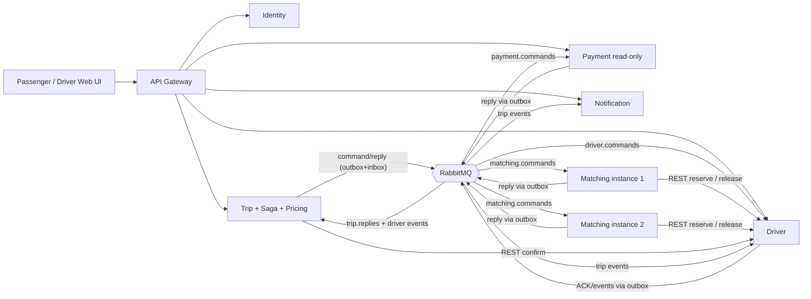
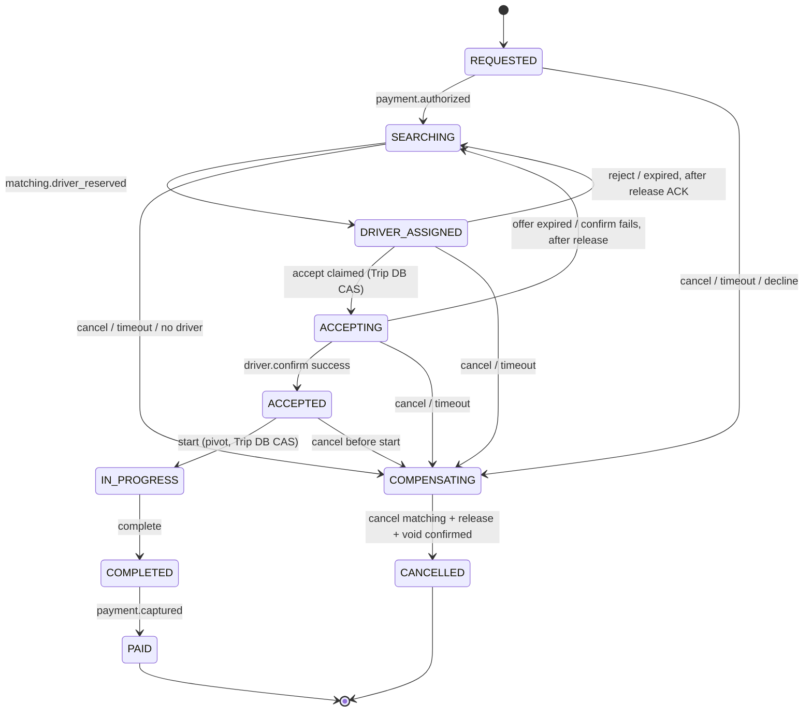
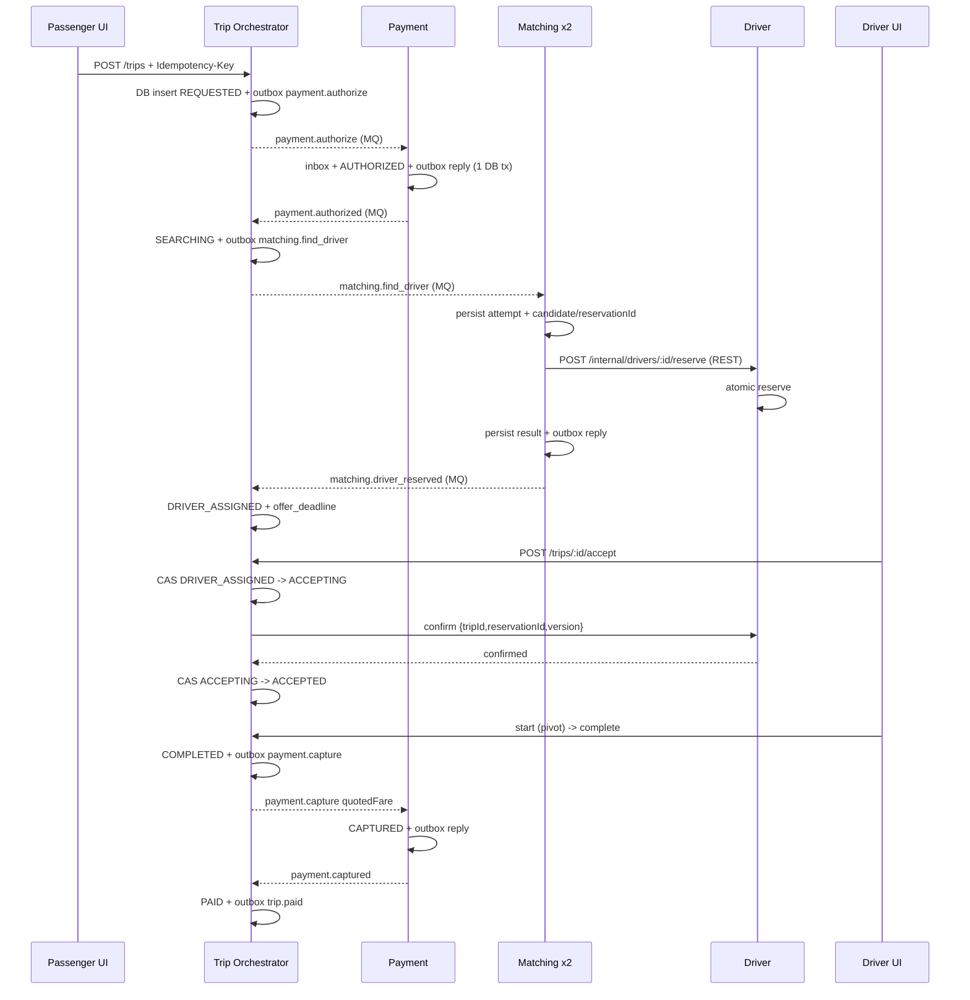

# PLAN v5 – DS03: Ride-Hailing Microservices (mô phỏng Grab/Uber)

> **Học phần:** Distributed Systems · **Nhóm:** 03 thành viên · **Phiên bản:** v5  
> **Hạn nộp duy nhất:** **22/11/2026** (nộp GitHub repository + báo cáo theo Specification).  
> **Cơ sở:** `COURSE PROJECT SPECIFICATION.pdf` (mục 4, 7, 9–13) và `plan.md` v2.  
> **Trạng thái:** Kế hoạch thiết kế, **chưa phải** bằng chứng đã lập trình / chạy kiểm thử.  
> **Nguyên tắc:** Đáp ứng đầy đủ yêu cầu bắt buộc trước; kỹ thuật nâng cao chỉ giữ nếu phục vụ trực tiếp độ tin cậy và demo.

**Thay đổi từ v4 sang v5 (chỉ phân công và luồng triển khai):** chuyển `notification-service` từ TV3 sang TV1; TV1 làm owner của E2E/integration scripts/demo automation; TV2 giữ Trip/Saga/Payment; TV3 tập trung Driver/Matching/Messaging và performance. Không thay đổi yêu cầu bắt buộc, 6 business services, invariant, event protocol hoặc hạn nộp. Các con số độ khó chỉ là ước lượng tương đối để cân bằng khối lượng.

## 0. Hạn nộp và các thay đổi kỹ thuật

**Hạn nộp duy nhất: 22/11/2026.** Đây là mốc ngày duy nhất được dùng để điều phối dự án. Không đặt thêm deadline trung gian, ngày MVP, ngày code freeze, ngày thi hoặc lịch demo trong kế hoạch này. Việc triển khai được quản lý bằng **thứ tự ưu tiên, phụ thuộc và tiêu chí nghiệm thu**; nhóm tự quyết định thời điểm thực hiện các giai đoạn, miễn tất cả đầu ra bắt buộc hoàn tất trước khi nộp.

**Hồ sơ phải có khi nộp:** repository chạy được theo `README.md`, lịch sử Git của cả 3 người, `docs/report.pdf`, mã nguồn, deploy/test/scripts, `.env.example`, minh chứng kiểm thử và hướng dẫn demo đủ 9 tình huống. Nếu repo private, cấp quyền truy cập cho giảng viên. Kiểm tra lại đăng ký nhóm và MSSV, nhưng không coi đây là một mốc lịch bổ sung.

### 0.1 Những quyết định kỹ thuật được giữ từ v4

1. **Transactional outbox** ở `trip-service`, `payment-service`, `matching-service`, `driver-service` cho các luồng thay đổi DB rồi gửi message; `notification-service` chỉ cần inbox nếu không phát event.
2. Tách **trạng thái Trip** khỏi **trạng thái Saga**; thêm `ACCEPTING`, `COMPENSATING` và trạng thái compensation chờ ACK. Không đánh dấu `CANCELLED` khi `void` / `release` chưa chắc chắn hoàn thành.
3. Bổ sung **tombstone** cho Payment, **cancel matching attempt** cho Matching, bảo vệ kết quả / sự kiện đến muộn.
4. **Atomic reserve + reservationId/version** (fencing) để không nhận hoặc release nhầm reservation mới; `accept`/`cancel`/`start` được tuần tự hóa bằng transaction trên Trip DB.
5. Cấu hình retry RabbitMQ theo **application-managed retry count + republish with publisher confirm rồi ACK**, không giả định broker tự tăng `x-retry-count`.
6. Chốt **giá cước tại thời điểm đặt** (`quotedFare = authorizedAmount = captureAmount` trong MVP), không có trường hợp capture vượt khoản giữ tiền.
7. Chuyển runtime sang **Node.js 24 LTS**; pin dependency trong lockfile và Dockerfile.
8. Kiểm tra partial failure, Saga compensation và concurrency **trước khi hoàn thiện UI**, không để lại tới giai đoạn cuối.

---

## 1. Mục tiêu, yêu cầu gốc và phạm vi

### 1.1 Đối chiếu với Course Specification

| Nguồn Specification | Yêu cầu gốc | Cách đáp ứng / minh chứng |
|---|---|---|
| §4.1 | ≥ 3 process độc lập, giao tiếp qua mạng, định danh, concurrency, log | 6 business services + gateway, container riêng, REST / RabbitMQ, `instanceId`, test C01–C06 |
| §4.2 | Kiến trúc, naming/discovery, protocol/format, state, online/offline, timeout/ACK/retry, duplicate/order, performance | Mục 2–5, event catalog, health/heartbeat, log/metrics |
| §4.3 | ≥ 1 tình huống tương tranh và đảm bảo trạng thái cuối | Atomic reserve; accept vs cancel; test C01–C06 |
| §4.4 | ≥ 2 failure scenarios + recovery | Kill Payment/Matching/Driver/RabbitMQ; test X01–X10 |
| §4.5 | Auth, access control, validation, không lộ secret, giới hạn size, log | JWT, RBAC, internal token, input schema, `.env.example` |
| §7.2 | **≥ 4 business services**, mỗi service có dữ liệu/schema riêng, cấm đọc DB của nhau | 6 business services, 6 PostgreSQL riêng |
| §7.3 | Auth/role, driver status/location, booking, matching, accept/reject, không double assignment, trip, fare/payment, notifications; REST + MQ; event ID/idempotency, retry, dedup, DLQ, correlation, Saga | API + state machine + message catalog + Saga + tests |
| §7.4 | **9 kịch bản demo bắt buộc** | Mục 9 |
| §7.5 | Gateway, outbox, scale nhiều instance... là **advanced features** | Chỉ chọn gateway, outbox, matching ×2 vì hữu ích cho reliability/demo; không coi là yêu cầu bắt buộc của đề |
| §9 | ≥ 8 functional + 2 concurrency + 2 fault/recovery + 2 security/invalid + 1 performance | Mục 8 với điều kiện pass/fail kiểm chứng được |
| §10–11 | Repo cấu trúc cố định, report 20–30 trang, slides nếu có, demo log/failure/concurrency, mọi thành viên tham gia | Mục 7, 10, 11 |
| §12–13 | Không shared DB, không thiếu demo, từng người có commit, trích dẫn và chịu trách nhiệm mã nguồn | Checklist cuối và Git history |

**Phân biệt bắt buộc và tự nâng cao:** Specification không bắt buộc 6 services, PostgreSQL riêng từng container, orchestration, outbox ở mọi service, k6, React hay 2 matching instances. Nhóm **chủ động chọn** các kỹ thuật đó; nếu trễ phải ưu tiên yêu cầu gốc và một Saga thật sự hoạt động.

### 1.2 Mục tiêu chất lượng

- Hành khách tạo yêu cầu -> Matching chọn tài xế -> Driver accept -> start -> complete -> Payment capture -> Trip `PAID` -> notification.
- Hai hành khách cùng đặt một tài xế: **tối đa một reservation/current trip hợp lệ tại mọi thời điểm**.
- Service crash khi xử lý message: có thể khôi phục; xử lý trùng không gây tác dụng nghiệp vụ trùng; message không được ACK trước khi commit DB và persist reply/outbox cần thiết.
- Saga xảy ra lỗi trước `start`: compensation eventually hoàn tất; không giữ tiền hoặc tài xế mồ côi.
- Có log và test tự động chứng minh, không chỉ đưa sơ đồ.

### 1.3 Ngoài phạm vi

Không làm GPS thật, payment thật, dynamic/surge pricing, WebSocket bắt buộc, routing bản đồ, Kafka, Kubernetes, leader election, Consul, distributed tracing đầy đủ, HA RabbitMQ/DB. Chỉ mô phỏng 1 máy qua Docker Compose (Specification cho phép các process/container và network độc lập).

---

## 2. Kiến trúc và công nghệ

### 2.1 Thành phần

| Component | Port nội bộ | Trách nhiệm | Lưu trữ |
|---|---:|---|---|
| `web-ui` (không tính business service) | 3000 | React Passenger/Driver; polling 2s; không chứa logic khóa tài xế | — |
| `api-gateway` (không tính business service) | 8080 | HTTP routing, verify JWT, RBAC mức gateway, rate limit, CORS, correlation ID, chặn `/internal/*` | — |
| `identity-service` | 8081 | Register/login, PASSENGER/DRIVER/ADMIN, JWT | `identity-db` |
| `driver-service` | 8082 | Driver availability/location, heartbeat, atomic reserve, confirm, release, TTL, fencing, outbox | `driver-db` |
| `trip-service` | 8083 | Booking, Pricing nội bộ, Trip lifecycle, Saga orchestrator, outbox, timeout/reconciler | `trip-db` |
| `matching-service` (2 instance) | 8084 | Competing consumers; choose nearby driver, persist matching attempt, claim/lease, reserve qua Driver REST, cancel attempt, outbox | `matching-db` |
| `payment-service` | 8085 | Simulated authorize, void, capture, tombstone, replay-safe replies, outbox, chaos mode | `payment-db` |
| `notification-service` | 8086 | Inbox + lưu notification và `GET /notifications/me` | `notification-db` |
| `rabbitmq` | 5672 / 15672 | Durable command/event queues, retry queues, DLQ; named volume | volume riêng |
| `dozzle` (tùy chọn) | 9999 | Xem log tập trung đơn giản khi demo | — |

**DB isolation:** 6 PostgreSQL containers / 6 databases và credentials riêng; tất cả truy cập liên service qua HTTP hoặc MQ, **không truy vấn chéo DB**. Nếu máy yếu có thể dùng 1 PostgreSQL server với 6 *database/schema và user được phân quyền riêng*, chỉ sau khi xác nhận thỏa §7.2, §12 của đề; phương án nộp mặc định vẫn là DB riêng từng service.

### 2.2 Stack

| Hạng mục | Công nghệ |
|---|---|
| Runtime | **Node.js 24 LTS** + TypeScript, npm workspaces + `package-lock.json` |
| HTTP | Fastify + plugin proxy, JWT, rate-limit, CORS |
| DB | PostgreSQL 16, `pg`, `node-pg-migrate`; SQL transaction tường minh |
| Message broker | RabbitMQ, `amqplib` + `amqp-connection-manager`, publisher confirms |
| Schema | Zod trên REST và message envelope/payload |
| Logging | Pino structured JSON; `service`, `instanceId`, `correlationId`, `tripId`, `eventId`, `operation`, `result` |
| UI | React + Vite + TypeScript, polling (không Map API) |
| Test | Vitest, HTTP integration, Bash/PowerShell, k6, seed/simulator |
| Deploy | Docker Compose, healthcheck, volumes cho DB/MQ, giới hạn resource hợp lý |

**Lý do:** Node 24 còn được hỗ trợ, còn Node 20 đã EOL. Không nâng major dependency sát ngày nộp; chốt npm lockfile và Docker image tag đã kiểm thử.

### 2.3 Sơ đồ tổng thể



### 2.4 Naming, discovery, online/offline

- Service identity: `SERVICE_NAME`, `INSTANCE_ID` duy nhất từng container; trong logs, producer của envelope.
- Business identifiers: UUID v4 `userId`, `driverId`, `tripId`, `paymentId`, `eventId`, `reservationId`; `matchAttempt` tăng đơn điệu theo trip.
- Discovery: Docker DNS (`http://driver-service:8082`); Matching dùng competing consumers trên `matching.commands`, **không cần gọi HTTP giữa hai instance**. Giới hạn: không dynamic registry, không cross-host failover; nêu trong báo cáo.
- Service health: `/health` kiểm tra process; `/ready` kiểm tra khả năng phục vụ yêu cầu cốt lõi (ít nhất DB); `/dependencies` cho DB/broker. Broker mất có thể nhận yêu cầu và ghi outbox **nếu DB còn hoạt động**, đồng thời báo trạng thái degraded; không quảng cáo end-to-end hoàn tất tức thì.
- REST có timeout 2s, retry giới hạn với endpoint **idempotent**; dùng exponential backoff ngắn và phân biệt 4xx nghiệp vụ với 5xx/network.
- Driver heartbeat: UI/simulator gửi 5s/lần; sau 30s không heartbeat, chỉ chuyển `AVAILABLE -> OFFLINE`; driver `RESERVED`/`ON_TRIP` không bị job heartbeat xóa reservation/chuyến, mà đánh dấu `last_seen_at` và xử lý theo timeout riêng.

---

## 3. Invariant và mô hình trạng thái

### 3.1 Những invariant phải đúng

| Mã | Invariant | Nơi đảm bảo |
|---|---|---|
| I01 | Một `driverId` có **tối đa 1** `current_trip_id/reservation_id` hợp lệ | 1 dòng Driver DB, atomic conditional update |
| I02 | Không có 2 Trip `ACCEPTED`/`IN_PROGRESS` cùng một Driver | Driver confirm có fencing + Trip nhận đúng reservation |
| I03 | Một Passenger có tối đa 1 Trip **chưa kết thúc** (kể cả `COMPENSATING`) | Unique partial index tại Trip DB |
| I04 | Một payment cho một Trip không bị authorize/capture/void gây tác động lặp | DB unique `trip_id`, operation idempotency, inbox |
| I05 | `CANCELLED` chỉ khi cleanup/compensation đã xác nhận; `PAID` chỉ khi capture thành công | Saga orchestrator + reply/REST reconciliation |
| I06 | Message cũ không ghi đè state mới hay release reservation mới | attempt, state/version, reservationId, fencing |
| I07 | Không có consumer ACK khi chưa persist nghiệp vụ và outbox reply | Transaction + inbox + manual ACK |

### 3.2 Trip state machine



- `trips`: `id, passenger_id, driver_id, reservation_id, quoted_fare, status, version, match_attempt, saga_deadline, offer_deadline, cancel_reason, created_at, updated_at`.
- **Trip business status** tách khỏi `saga_status` (`RUNNING | COMPENSATING | COMPLETED | CANCELLED`) và `compensation_steps` (`match_cancel_ack`, `driver_release_ack`, `payment_void_ack`).
- CAS trên `trips` (`WHERE id=$id AND status=$expected AND version=$oldVersion`), 0 row → không được ghi đè; xử lý lại hoặc `409` có mã rõ ràng.
- `CANCELLED` là terminal sau compensation. `IN_PROGRESS` là **pivot**; sau pivot chỉ forward recovery, không gọi `payment.void` để rollback một chuyến đã chạy.
- Nếu `payment.declined`, có thể kết thúc sau khi đã nhận trạng thái chính thức không giữ tiền; vẫn đi qua logic `COMPENSATING` / no-op compensation nhất quán.
- `CANCELLED` không thể tiếp tục `ACCEPTED/IN_PROGRESS`; reply đến muộn phải được xử lý theo nghiệp vụ, không chỉ bỏ qua.

### 3.3 Driver reservation / fencing

Mỗi lần đặt tài xế có `reservationId` (UUID được Matching lưu bền vững **trước khi** gọi REST), `tripId`, `matchAttempt`, `driverId` và `reservationVersion` (tăng khi cấp reservation mới). Driver lưu `status, current_trip_id, reservation_id, reservation_version, reserved_until, version`.

```sql
-- Chỉ một request thắng; status nằm trên 1 row nguồn sự thật.
UPDATE drivers
SET status = 'RESERVED', current_trip_id = $tripId,
    reservation_id = $reservationId,
    reservation_version = reservation_version + 1,
    reserved_until = now() + interval '30 seconds',
    version = version + 1
WHERE id = $driverId AND status = 'AVAILABLE'
RETURNING reservation_version;
```

- Idempotency: lặp `reserve` **cùng** `(driverId, tripId, reservationId)` → trả reservation đã cấp nếu còn hiệu lực; khác reservation → 409; không tạo reservation mới trên retry.
- `confirm` kiểm tra `RESERVED`, `tripId`, `reservationId`, `reservationVersion`, `reserved_until > now()`; chuyển `ON_TRIP`. Nếu đã `ON_TRIP` với chính reservation đó → trả 200 idempotent.
- `release` kiểm tra **đúng trip + reservationId + version**, và chỉ được gọi khi Trip đã chấp nhận `cancel/reject/timeout` (trước pivot). Nếu đã giải phóng chính reservation đó → trả ACK idempotent; nếu Driver hiện sở hữu reservation **khác**, ACK no-op `STALE_RELEASE` (không reset driver mới).
- TTL job quét `RESERVED` quá hạn bằng conditional update; phát `driver.reservation_expired` **qua outbox cùng transaction**. Sau khi hết hạn, `confirm` trả `409 OFFER_EXPIRED`.
- `trip.completed` release `ON_TRIP -> AVAILABLE` phải kiểm tra trip + reservation hiện tại; event cũ/trùng không ảnh hưởng trip khác.
- Chỉ dựa vào `tripId` là chưa đủ nếu phải phòng request trễ/cũ; `reservationId/version` là fencing token.

---

## 4. Saga Orchestration, bù trừ và xử lý race

### 4.1 Luồng happy path và nguồn sự thật



**Pricing MVP:** `quotedFare` được tính một lần bằng công thức cơ bản (baseFare + perKm × khoảng cách giả lập) rồi được **đóng băng** khi tạo Trip. `authorizeAmount = captureAmount = quotedFare`. Không phát sinh thu thêm/chênh lệch sau chuyến. Nếu muốn tính fare động, đó là thay đổi phạm vi cần một bước authorize bổ sung, **không** tự capture lớn hơn hold.

### 4.2 Compensation protocol (bền vững và có xác nhận)

Khi `PASSENGER_CANCELLED | PAYMENT_DECLINED | NO_DRIVER | SAGA_TIMEOUT | OFFER_TIMEOUT` trước pivot:

1. Trip dùng CAS chuyển sang `COMPENSATING`, lưu lý do và tạo `compensation_steps` bền vững (không ghi `CANCELLED` ngay).
2. Gửi `matching.cancel_attempt {tripId, matchAttempt}`. Matching ghi trạng thái `CANCEL_REQUESTED` / tombstone nếu attempt chưa tồn tại; kiểm tra còn in-flight reserve, release reservation nếu đã cấp, **chỉ ACK** `matching.attempt_cancelled` khi đã không còn reservation do attempt đó nắm. Khi worker hoàn tất trễ, nó đọc trạng thái `CANCEL_REQUESTED` và phải release/không công bố kết quả mới.
3. Nếu Trip đã biết reservation, gửi `driver.release {tripId, reservationId, reservationVersion}` (hoặc matching release trong quá trình cancel attempt); Driver trả `driver.released` / `STALE_RELEASE` qua outbox, có xác nhận chính xác reservation. Chỉ coi `driver_release_ack=true` khi có ACK hoặc truy vấn đối soát khẳng định không còn reservation của Trip.
4. Gửi `payment.void {tripId}`. Payment xử lý **kể cả khi chưa có hàng Payment** bằng cách ghi tombstone `VOIDED/CANCELLED` cho trip; authorize đến sau bị từ chối (`payment.authorize_rejected_cancelled`). Nếu đang `AUTHORIZED`, void chuyển thành `VOIDED`; lặp void trả trạng thái cũ và reply bền vững.
5. Trip nhận `matching.attempt_cancelled`, `driver.released` (nếu cần), `payment.voided` và đối soát `state` rồi mới chuyển `CANCELLED`, publish `trip.cancelled` + notify. **Không xóa trạng thái bù trừ trên lỗi kỹ thuật**.
6. Nếu Payment/Driver/Matching down, job reconciler scan mọi Saga `COMPENSATING` sau restart, retry lệnh idempotent; nếu quá giới hạn retry, đặt `NEEDS_RECONCILIATION`, giữ Trip chưa terminal và hiện cảnh báo admin/log + DLQ; sau replay tiếp tục.

**Invariant quan trọng:** `CANCELLED` không đồng nghĩa "đã gửi lệnh void/release" mà đồng nghĩa "đã nhận/đối soát kết quả cleanup".

### 4.3 Các trường hợp đến muộn và crash point

| Tình huống | Xử lý đúng |
|---|---|
| Payment `AUTHORIZED` nhưng crash trước reply | Payment DB+outbox chứa reply; poller publish sau restart; nếu Trip đã yêu cầu cancel thì `payment.void` tombstone/idempotent đảm bảo không giữ tiền mồ côi |
| `payment.authorized` đến sau Saga timeout | Trip không chuyển lại SEARCHING; đảm bảo gửi/retry `payment.void`, đối soát trước terminal |
| Matching đã reserve nhưng crash trước reply | Matching có persisted attempt/candidate/reservationId, retry REST cùng reservationId; eventual reply hoặc cancel+release |
| `matching.driver_reserved` đến sau cancel | Không gán Trip; đảm bảo release của reservation đó, hoàn tất `matching.cancel_attempt` |
| Offer hết hạn, late accept | Driver confirm kiểm tra `reserved_until` + fencing, trả 409; Trip release/rematch hoặc bù trừ |
| Driver confirmed nhưng Trip crash trước `ACCEPTED` | Trip ở `ACCEPTING`; background reconciler gọi lại confirm (idempotent) hoặc release nếu đã cancel |
| Payment capture thành công, crash trước reply | Payment outbox phát lại `payment.captured`; Trip chỉ lên `PAID` khi nhận/đối soát `CAPTURED` |
| Driver release quá trễ sau reservation kế tiếp | Driver kiểm tra `reservationId/version` cũ → `STALE_RELEASE`, không ảnh hưởng reservation mới |

### 4.4 Accept / cancel / start race (không giao dịch chéo DB)

- `accept`: khóa/CAS trạng thái Trip `DRIVER_ASSIGNED -> ACCEPTING` kèm `acceptOperationId`, sau đó gọi Driver `confirm`. Không giữ DB transaction đang mở trong lúc gọi REST. Reconciler phục hồi `ACCEPTING` sau crash.
- `cancel`: CAS ở Trip DB từ `REQUESTED/SEARCHING/DRIVER_ASSIGNED/ACCEPTING/ACCEPTED -> COMPENSATING`. Nếu `start` đã thắng và Trip ở `IN_PROGRESS`, trả `409 TOO_LATE_TO_CANCEL` (không trả thành công giả).
- `start`: chỉ CAS `ACCEPTED -> IN_PROGRESS` nếu đúng driver, **pivot**. Nếu cancel thắng, start trả 409; nếu start thắng, cancel trả 409.
- Nếu `confirm` REST thành công **sau** khi cancel thắng, reconciler/flow accept nhìn thấy `COMPENSATING` và gửi `driver.release`, không ghi `ACCEPTED`. Driver chỉ release `ON_TRIP` cho đúng reservation theo quyết định cancel trước pivot của Trip.
- Không cho Driver tự chuyển `IN_PROGRESS` từ client hoặc dựa trên một event chưa xác thực từ UI. Trip DB là nguồn sự thật cho pivot.

### 4.5 Timeout và bounded recovery

| Deadline / timeout | Mặc định | Cách xử lý |
|---|---:|---|
| REST Matching/Trip -> Driver | 2s/request, tối đa 2 retry | Chỉ retry endpoint idempotent; lỗi 409 nghiệp vụ không retry |
| Offer/Driver reservation | 30s | Driver TTL expire, Trip có `offer_deadline` riêng để không chờ event vô hạn |
| Saga pre-pivot (authorize + matching) | 90s | Trip bắt đầu compensation; vẫn tiếp tục cleanup dù vượt deadline |
| `ACCEPTING` chưa được xác nhận | 10s hoặc trước reservation expiry | Reconcile confirm; nếu không thể hoàn tất đúng hạn -> compensation hoặc rematch (sau release ACK) |
| Compensation step chưa ACK | Quét mỗi 2s + retry có backoff | Không terminal, cảnh báo/DLQ nếu vượt budget, có script reconcile |
| Capture lỗi kỹ thuật sau pivot | 1s, 5s, 15s rồi DLQ/replay | Giữ `COMPLETED` với `paymentStatus=CAPTURE_PENDING`, không `PAID` giả |

**Rematch:** Không gửi `matching.find_driver` attempt mới trước khi attempt cũ được `matching.attempt_cancelled`/Driver release xác nhận. `match_attempt` tối đa **3**. Driver đã reject/expired được loại trừ, matching candidate list deterministic theo khoảng cách giả lập và `driverId` tie-break.

---

## 5. Messaging, inbox/outbox, retry và recovery

### 5.1 RabbitMQ topology

- Exchange `ride.commands` (direct): command + reply point-to-point qua routing keys rõ ràng.
- Exchange `ride.events` (topic): publish những event có nhiều consumer.
- Durable main queues: `payment.commands`, `matching.commands`, `driver.commands`, `trip.replies`, `trip.driver-events`, `driver.trip-events`, `notification.events`.
- `trip.driver-events` bind `driver.*`; `driver.trip-events` bind `trip.*`; `notification.events` bind `trip.*` và event thông báo cần thiết khác. Không chia 1 queue broadcast giữa nhiều service khác nhau.
- Mỗi queue xử lý nghiệp vụ có retry queues `.retry.1s/.retry.5s/.retry.15s`, dead-letter qua TTL quay về main queue, và `.dlq` riêng. Khởi tạo topology qua scripts/definitions; cấu hình cố định, dễ kiểm tra ở Management UI.
- `delivery_mode=2` (persistent), durable exchange/queue, publisher confirms, manual ACK, `prefetch=5`, named volume RabbitMQ. Không tuyên bố broker luôn HA: nếu broker/down volume hỏng hoặc host mất thì ngoài failure model MVP.

### 5.2 Event envelope (chốt dùng chung)

```json
{
  "eventId": "uuid-v4",
  "type": "payment.authorized",
  "schemaVersion": 1,
  "occurredAt": "2026-11-10T08:00:00.000Z",
  "correlationId": "uuid-v4",
  "causationId": "eventId-message-truoc-hoac-null",
  "producer": {
    "service": "payment-service",
    "instanceId": "payment-service-1"
  },
  "aggregateId": "tripId-uuid-v4",
  "aggregateVersion": 3,
  "matchAttempt": 1,
  "payload": {
    "tripId": "tripId-uuid-v4"
  }
}
```

- Phân biệt `eventId` (định danh **một message logic**), `correlationId` (theo vết toàn bộ trip), `causationId` (nguyên nhân), `tripId` (nghiệp vụ), `reservationId`/`reservationVersion` (quyền thao tác driver).
- Khi retry **cùng message logic**, giữ nguyên `eventId`, tăng `retryCount` ở AMQP header; khi tạo message kết quả mới dùng `eventId` mới.
- `aggregateVersion` giúp nhận biết message cũ; không được suy luận rằng timestamp vật lý sẽ đảm bảo total ordering giữa các service.

### 5.3 Danh mục command/reply/event

| Message | Producer -> Consumer | Bắt buộc phản hồi / lưu |
|---|---|---|
| `payment.authorize`, `payment.void`, `payment.capture` | Trip -> Payment (`payment.commands`) | Payment DB+outbox cùng tx |
| `payment.authorized`, `payment.declined`, `payment.voided`, `payment.captured`, `payment.authorize_rejected_cancelled` | Payment -> Trip (`trip.replies`) | Reply durable |
| `matching.find_driver`, `matching.cancel_attempt` | Trip -> Matching (`matching.commands`) | Matching attempt/tombstone + outbox |
| `matching.driver_reserved`, `matching.no_driver`, `matching.attempt_cancelled` | Matching -> Trip (`trip.replies`) | Có `matchAttempt`, reservation token |
| `driver.release` | Trip -> Driver (`driver.commands`) | Driver CAS, outbox reply |
| `driver.released`, `driver.reservation_expired` | Driver -> Trip (reply / `ride.events`) | ACK/release/TTL có reservation token |
| `trip.requested`, `trip.accepted`, `trip.started`, `trip.completed`, `trip.cancelled`, `trip.paid` | Trip -> Driver/Notification (`ride.events`) | Các consumer có queue riêng |

**Quan trọng:** `driver.released` cho Saga **không** được chỉ dựa trên best-effort event không có durable outbox. `matching.attempt_cancelled` cũng vậy.

### 5.4 Transactional outbox + inbox (bắt buộc theo thiết kế nhóm)

**Các service phát reply/event sau thay đổi DB:** Trip, Payment, Matching, Driver dùng:

- `outbox(id PK, event_id UNIQUE, exchange, routing_key, envelope, status, attempt_count, next_attempt_at, created_at, sent_at)`.
- `processed_messages(event_id PK, received_at)` cho mọi consumer.
- Trong **một DB transaction**: validate -> insert inbox (nếu duplicate thì không áp tác dụng lần nữa) -> cập nhật nghiệp vụ -> ghi outbox reply/event (nếu có) -> commit.
- Outbox publisher lấy batch `FOR UPDATE SKIP LOCKED`, publish với confirms, sau confirm cập nhật `SENT`; crash giữa confirm và update có thể publish lặp — **consumer inbox phải dedup**.
- Nếu lặp command **đã xử lý** mà reply chưa tới, outbox vẫn còn nhiệm vụ gửi reply; không đơn thuần drop command và hy vọng requester tự biết kết quả.
- Notification consumer: insert inbox + notification trong một transaction; unique `(user_id, event_id, type)` để không thông báo trùng.

**Mức cam kết:** At-least-once delivery + business idempotency; “effectively-once” chỉ đối với **tác dụng nghiệp vụ đã thiết kế idempotent**, **không** tuyên bố broker cung cấp exactly-once delivery.

### 5.5 Retry queue chính xác (không vòng lặp vô hạn)

**Transient lỗi kỹ thuật** (DB tạm down, HTTP 5xx/timeout, broker reconnect):

1. Consumer rollback transaction (inbox **không** được ghi thành công nếu xử lý thất bại).
2. Đọc AMQP header `retryCount` (mặc định 0), kiểm tra budget.
3. Nếu `retryCount < 3`: **republish** message giữ nguyên `eventId` vào queue delay tương ứng (`1s/5s/15s`), header `retryCount+1`, có publisher confirm; sau confirm mới **ACK original**.
4. Nếu hết 3 retry: republish tới `<main-queue>.dlq` với `lastError`, `failureTime`, confirm rồi ACK original; hiển thị cảnh báo và cho phép replay.
5. Nếu publish retry/DLQ lỗi, **không ACK original**; reconnect/backoff rồi để broker redeliver; tránh `nack(requeue=true)` liên tục không giới hạn.
6. TTL của retry queue tự dead-letter về main queue, **không** tự tăng `retryCount`. RabbitMQ `x-death` phục vụ diagnostics; app quản lý `retryCount` rõ ràng.
7. Message sai schema/không thể sửa -> trực tiếp DLQ (không retry). Lỗi nghiệp vụ (`PAYMENT_DECLINED`, `NO_DRIVER`, `OFFER_EXPIRED`) -> commit nghiệp vụ + outbox reply, **không** retry như lỗi hệ thống.
8. Replay DLQ chỉ sau khi nguyên nhân đã sửa; script giữ `eventId` gốc (nếu chưa xử lý thành công) và reset retry header có audit log; replay đã xử lý thì inbox bỏ qua.

**Lưu ý crash window:** Republish confirmed nhưng crash trước ACK sẽ có 2 bản cùng `eventId`; inbox + operation idempotency xử lý an toàn. Với lỗi xảy ra trước commit inbox, các bản có thể cùng retry nhưng cuối cùng chỉ một tác động được commit.

### 5.6 REST retries và idempotency HTTP

- `POST /trips` yêu cầu `Idempotency-Key` (scoped theo `userId`), `request_hash` trên body canonicalized; unique `(user_id, key)`.
- 10 POST song song cùng key: transaction insert/get row với `UNIQUE` + `SELECT ... FOR UPDATE` (hoặc ON CONFLICT có đợi), tạo **duy nhất 1 trip**; cùng key/body trả **cùng tripId/status/response nghiệp vụ**, khác body -> `422 IDEMPOTENCY_KEY_REUSED`. Không dùng check-then-insert không khóa.
- `reserve`, `confirm`, `release` idempotent theo reservation token; Payment idempotent theo `tripId + operation` và trạng thái (không authorize sau tombstone); `cancel_attempt` idempotent theo `tripId + matchAttempt`.
- Các internal REST call có `X-Correlation-ID`, `X-Internal-Token`, timeout, log và response code phân loại 409 so với lỗi 503.

### 5.7 Matching concurrency giữa hai instance

- Bảng `match_attempts` unique `(trip_id, attempt)`, các state `PENDING | RUNNING | RESERVING | RESERVED | CANCEL_REQUESTED | CANCELLED | FAILED`.
- Worker claim bằng DB CAS/lease có `claim_token`, `claimed_until`; không giữ transaction mở khi gọi REST. Nếu worker chết, worker khác recover theo lease.
- Ghi `candidate_driver_id` và **`reservation_id` trước REST**; retry lại cùng reservation ID, tuyệt đối không tự sinh ID mới khiến một attempt có nhiều reserve.
- Nếu `cancel_attempt` đến khi chưa thấy attempt, lưu **tombstone** unique `(tripId,attempt)`; lệnh `find_driver` đến muộn không được bắt đầu.
- Nếu cancel đến khi `RESERVING`, worker/reconciler phải hoàn tất release/kiểm tra trạng thái Driver trước ACK cancel; không trả thành công khi còn REST reserve in-flight chưa được phân xử.
- Nếu hai instance tranh cùng driver cho **hai Trip khác nhau**, Driver DB conditional update chỉ cho một request thành công. Instance thua chuyển thử candidate khác/`matching.no_driver`, không gán kép.
- Nếu worker lease hết hạn khi REST cũ chưa trả lời, **fencing claim_token** trước khi persist kết quả; cùng reservationId làm việc gọi lại Driver an toàn. Reconciler dọn reservation dư nếu attempt đã bị cancel.

---

## 6. REST API, Security, Observability và Performance

### 6.1 API ngoài (qua Gateway)

| Vai trò | API |
|---|---|
| Anonymous / Identity | `POST /auth/register`, `POST /auth/login`, `GET /users/me` |
| Driver | `GET /drivers/me`, `PUT /drivers/me/status`, `PUT /drivers/me/location` |
| Passenger | `POST /trips` (Idempotency-Key), `GET /trips/{id}`, `GET /trips/me/active`, `POST /trips/{id}/cancel` |
| Driver trip | `GET /trips/offers`, `POST /trips/{id}/accept`, `/reject`, `/start`, `/complete` |
| Payment read-only | `GET /payments/{tripId}` (chủ trip/ADMIN), không expose authorize/void/capture ra ngoài |
| Notification | `GET /notifications/me?since=` |
| Admin chaos | Chỉ bật `CHAOS_ENABLED=true` trong demo, route nội bộ có internal auth + ADMIN |

**Nội bộ Driver:** `GET /internal/drivers/available`, `POST /internal/drivers/{id}/reserve`, `/confirm`, `/release`, `GET /internal/drivers/{id}/reservation/{reservationId}` để reconciliation. **Nội bộ Payment:** `GET /internal/payments/{tripId}/status` để reconciliation. **Nội bộ Matching:** `GET /internal/matching/{tripId}/{attempt}` nếu cần repair. Không cho client trực tiếp gửi internal commands.

Trả lỗi thống nhất `{code, message, correlationId}`, mã 400/401/403/404/409/422/503 rõ ràng, OpenAPI trong `docs/openapi/`.

### 6.2 Security (§4.5)

- Mật khẩu Argon2/bcrypt, JWT access token ngắn hạn, role PASSENGER/DRIVER/ADMIN; **ownership** tại business service (không chỉ gateway).
- Chặn `/internal/*` tại gateway, internal token riêng trong env, hạn chế IP/network Docker; **không** tin client gửi `driverId`/`passengerId` thay cho ID lấy từ JWT.
- Zod validate request và event, validate UUID, lat/lng/range, giá cước dạng số nguyên đơn vị tiền (tránh float), giới hạn HTTP 10 KB và message size thích hợp, rate limit /login và `/trips`.
- Không commit `.env`, token, pass, secret; `.env.example` không chứa credential thật. Không log password/JWT/payment secret.
- RabbitMQ user quyền vừa đủ trên **cùng vhost hệ thống**; tách user DB và mật khẩu cho từng service.
- TLS tùy chọn cho demo local; nếu triển khai public thì HTTPS phải được kích hoạt.

### 6.3 Logging/tracing tối giản và chuẩn bằng chứng

Mọi log có `timestamp`, `service`, `instanceId`, `correlationId`, `tripId`, `eventId`, `operation`, `stateBefore`, `stateAfter`, `result`; log `OUTBOX_PUBLISHED`, `MESSAGE_DEDUPED`, `RETRY_SCHEDULED`, `DLQ`, `STALE_MESSAGE_IGNORED`, `COMPENSATION_ACK`, `CAS_CONFLICT`, `RESERVE_WON/LOST`.

- UI hiển thị correlationId của chuyến; script `logs-by-trip` dùng Dozzle hoặc `docker compose logs | grep`.
- Mỗi test cần lưu: lệnh chạy, seed, thời điểm kill, log, ảnh RabbitMQ, truy vấn kiểm tra invariant và kết luận pass/fail.

### 6.4 Hiệu năng/khả dụng (mục tiêu nội bộ, không phải KPI bắt buộc từ Specification)

- **Mục tiêu thử nghiệm:** p95 `POST /trips` (chỉ nhận yêu cầu/ghi outbox) < 300ms và p95 request → `DRIVER_ASSIGNED` < 3s trong môi trường đã warm-up, đủ driver AVAILABLE, broker bình thường.
- K6 đo `p50/p95`, throughput, success rate, thời gian nhận driver, CPU/RAM. Test các mức 10/50/100 VU sau khi load seed phù hợp, báo tài nguyên và số trường hợp bị từ chối vì thiếu driver **tách riêng**.
- Simulator hoàn tất/chuyển trạng thái các chuyến trong load test để tái sử dụng nguồn tài xế hợp lệ; không làm giả success bằng cách bỏ qua `accept`/`complete`.
- SPOF MVP: RabbitMQ 1 instance, gateway 1 instance, DB 1 instance mỗi service. Persistence/outbox giảm mất công việc trong crash-process, **không** bảo đảm hệ thống vẫn phục vụ nếu host hoặc storage mất. Phân tích rõ trong báo cáo.
- Scale Matching 1/2/3 instance: dùng competing consumers, so sánh throughput và contention; không mặc định scale luôn làm nhanh hơn khi Driver DB là bottleneck.

---

## 7. Phân công cân bằng 03 thành viên và quản lý Git

**Nguyên tắc:** 3 người đều có module, test, tài liệu và commit riêng. Mỗi công việc có **một người chịu trách nhiệm chính (owner)**, người còn lại hỗ trợ review/tích hợp. Không lấy số lượng commit làm thước đo duy nhất; phải có sản phẩm chạy được và giải thích được khi vấn đáp.

### 7.1 Ma trận trách nhiệm và đầu ra (phân công v5)

**Phân công chính:** TV1 nhận **Platform + Identity + Gateway + UI + Notification + E2E/demo**; TV2 nhận **Trip + Saga + Payment + Pricing + Recovery**; TV3 nhận **Driver + Matching + RabbitMQ + common/messaging + concurrency/performance**. Mỗi service có đúng **một owner**. Người hỗ trợ review nhưng không đồng sở hữu những thay đổi không có phân công.

| Thành viên | Owner của thành phần | Đầu ra bắt buộc | Độ khó tương đối (ước lượng, không phải điểm chấm) |
|---|---|---|---|
| **TV1 — Platform, Identity, UI, Notification, Integration** | `identity-service`, `api-gateway`, `notification-service`, `web-ui`; repo/Compose/CI/README; E2E và demo automation | Đăng ký/login/JWT/RBAC; API gateway; notification inbox/idempotency + API; UI Passenger/Driver; triển khai một lệnh; smoke/E2E/scripts và báo cáo tổng hợp | ~7.5–8/10 |
| **TV2 — Trip, Saga, Payment** | `trip-service`, `payment-service`, Pricing nội bộ; Saga, compensation/reconciler | Trip CAS/state machine; Booking/idempotency; authorize/void/capture + tombstone; outbox/inbox; accept/cancel/start race; Saga timeout + recovery | ~9/10 |
| **TV3 — Driver, Matching, Messaging** | `driver-service`, `matching-service` (2 instances), `common/messaging`; RabbitMQ topology; simulator/k6 | Atomic reserve/fencing/TTL; matching attempt/lease/cancel/tombstone; MQ/retry/DLQ/outbox tools; concurrency, fault về Driver/Matching và benchmark | ~9/10 |

**Phạm vi hỗ trợ:** TV3 cung cấp thư viện messaging có ví dụ consumer và tài liệu, **không phải** viết notification thay TV1; TV1 tự làm notification inbox, schema/migration và integration test. TV2 và TV3 tự tích hợp thư viện vào service mình sở hữu. TV1 chịu trách nhiệm automation E2E, **không thay** owner sửa bug nghiệp vụ của TV2/TV3.

### 7.2 Checklist cụ thể từng người

**TV1 — Platform, Identity, Notification và tích hợp toàn hệ thống**

- [ ] Khởi tạo monorepo npm workspaces, TS, lockfile, `.gitignore`, `.env.example`, lint/CI, cấu trúc thư mục và script chạy được trên máy sạch.
- [ ] Tạo Compose/healthchecks/network/volumes cho 6 PostgreSQL DB, RabbitMQ và service containers; mỗi service chạy và restart độc lập; cấu hình seed/migration orchestration.
- [ ] Xây `identity-service`: schema/migration, register/login, hash password, JWT roles và `/users/me`.
- [ ] Xây `api-gateway`: REST routing, JWT verify, RBAC biên, rate-limit, CORS, body-size, `X-Correlation-ID`, chặn `/internal/*`.
- [ ] **Xây `notification-service` (chuyển từ TV3):** notification DB/migration riêng; nhận `trip.*` bằng queue `notification.events`; inbox `(eventId)` và unique `(userId,eventId,type)` để chống trùng; API `GET /notifications/me?since=`, auth/ownership; **không** publish event, nên không cần outbox.
- [ ] Xây `web-ui`: Passenger tạo/xem/hủy chuyến; Driver online/location, offer/accept/reject/start/complete; polling 2s; hiển thị trạng thái và `correlationId`; thông báo được đọc qua notification API.
- [ ] **Owner E2E và demo automation:** script `start/seed/reset-demo/kill-service/logs-by-trip`, hai tài khoản Passenger + một Driver, script chạy happy path và 9 tình huống demo; kiểm tra các API qua gateway.
- [ ] **Kiểm thử owner:** F01, F02, F07 phần Notification, F10, S01–S05, X06; **E01–E03** (E2E); hỗ trợ chạy lại toàn bộ suite và lưu evidence. TV1 không tự tuyên bố PASS cho lỗi thuộc service khác.
- [ ] **Báo cáo owner:** 1–3, 12, phần Identity/Platform/UI/Notification của 13; biên tập bảng đóng góp, README, references/appendices và PDF cuối; điều phối tài liệu kết quả nhưng không viết thay phần kỹ thuật TV2/TV3.
- [ ] **Demo trình bày chính:** tình huống 1–3; hỗ trợ thao tác UI và reset giữa các demo của TV2/TV3.

**TV2 — Trip, Saga và Payment**

- [ ] `trip-service`: schema/migration, unique active-trip, state machine, CAS/version, `POST /trips` + `Idempotency-Key`, booking/accept/reject/start/complete/cancel.
- [ ] Pricing quote cố định và integer money; `authorizedAmount = captureAmount = quotedFare`.
- [ ] `payment-service`: authorize/void/capture idempotent, tombstone cho void-before-authorize, outbox/inbox, chaos technical/decline, status query để reconcile.
- [ ] Saga orchestrator Trip: command/reply qua MQ; states `ACCEPTING`/`COMPENSATING`; persisted compensation steps; `matching.cancel_attempt`, `driver.release`, `payment.void` và chờ ACK/đối soát trước `CANCELLED`.
- [ ] Trip reconciler/timeout; xử lý late replies, crash sau Driver confirm, capture pending sau pivot; mọi race accept/cancel/start dùng Trip CAS.
- [ ] Tích hợp và tự sở hữu migrations/outbox/inbox trong hai service bằng `common/messaging` của TV3; yêu cầu TV3 chỉnh **API thư viện**, không chuyển bug nghiệp vụ cho TV3.
- [ ] **Kiểm thử owner:** F04, F06, F07 phần Payment, F09, C03, C04, X01, X03, X07–X09; hỗ trợ E01–E03 và C01 khi cần Trip state.
- [ ] **Báo cáo owner:** 5, 10–11, phần Trip/Payment/Pricing của 13, phần nghiệp vụ/fault của 14; cung cấp test evidence có kiểm tra trạng thái DB.
- [ ] **Demo trình bày chính:** tình huống 7–9 (crash, retry/compensation, restart/recovery).

**TV3 — Driver, Matching và hạ tầng messaging**

- [ ] `driver-service`: schema/migration, heartbeat/location, AVAILABLE/RESERVED/ON_TRIP/OFFLINE; atomic conditional reserve, idempotent confirm/release, `reservationId/version` fencing, TTL expiry + event outbox.
- [ ] `matching-service` ×2: competing consumers, candidate ordering, persisted attempts, lease/claim token, lưu reservation ID trước REST, cancel attempt/tombstone, release/resume khi lỗi hoặc reply muộn.
- [ ] **Owner `common/messaging` và RabbitMQ definitions:** envelope/Zod, exchanges/routing, queue bindings (kể cả `notification.events`), outbox polling, inbox helpers, publisher confirms, retry count/TTL, DLQ + replay/audit.
- [ ] Cung cấp ví dụ tối thiểu `trip.event -> notification consumer -> inbox -> notification DB` để **TV1 tự triển khai service**; hỗ trợ kết nối/bind và review một PR tích hợp Notification.
- [ ] Simulator Driver/seed hỗ trợ TV1 (TV3 làm logic simulator, TV1 nhúng vào `reset-demo`); script concurrency và k6 10/50/100 VU, benchmark Matching 1/2/3 instance.
- [ ] **Kiểm thử owner:** F03, F05, F08, C01, C02, C05, C06, X02, X04, X05, X10, P01/P02; hỗ trợ E01–E03, X06 cùng TV1.
- [ ] **Báo cáo owner:** 4, 6–9, phần Driver/Matching/Messaging của 13, 15–17; cung cấp benchmark có dữ liệu thô và giới hạn đo lường.
- [ ] **Demo trình bày chính:** tình huống 4–6 (matching, hoàn thành chuyến qua Driver, concurrency); TV2 hỗ trợ chứng minh Trip/Payment ở tình huống 5.

### 7.3 Hợp đồng giữa các thành viên và tránh blocker

| Đầu ra / giao diện | Owner chốt | Bên phụ thuộc | Tiêu chí bàn giao sớm |
|---|---|---|---|
| Repo/CI, Compose services/DB/broker, env conventions | TV1 | TV2, TV3 | Từng service skeleton + DB migration + `/health` chạy độc lập; có `make`/npm command hoặc script tương đương |
| JWT claims, Gateway error & REST contracts | TV1 | TV2, TV3 | `userId`, `role`, token validation, `correlationId`, 400/401/403/409/422/503 thống nhất |
| Trip state, Saga command semantics | TV2 | TV1, TV3 | `docs/state-machine.md`; state transitions, reservation token, deadline, command/reply payload được duyệt |
| Event envelope/topology, `common/messaging` MVP | TV3 | TV1, TV2 | Test một event: `DB + outbox -> MQ -> consumer + inbox -> ACK`; doc subscription của Notification, event catalog versioned |
| Driver REST reserve/confirm/release, Matching attempts | TV3 | TV2 | OpenAPI/mock với idempotency, fencing, 409, cancel ACK; test contract giữa Trip và Driver |
| Notification consumer và read API | TV1 | TV2, TV3 | Bind `notification.events`, nhận trip event thực, ghi DB một lần khi event đến trùng, auth GET đúng user |
| Scripts seed/demo/E2E/report packaging | TV1 | TV2, TV3 | `reset-demo` deterministic, scripts gắn test ID và ghi artifacts; end-to-end chạy sau khi business API sẵn sàng |
| Invariant checks, Saga recovery evidence | TV2 | TV1, TV3 | Script xác minh Trip/Payment/Driver, bảng PASS/FAIL có điều kiện cuối cùng và logs |
| Concurrency/performance benchmark | TV3 | TV1, TV2 | Script reproducible; k6 output và contention metrics, không giả lập sự kiện hoàn thành sai nghiệp vụ |

**Đường găng và cách gỡ phụ thuộc:**

1. **TV1** tạo skeleton repo/Compose và mẫu env tối thiểu; không cần đợi UI hoàn thiện để TV2/TV3 bắt đầu viết service độc lập.
2. **TV2 + TV3** chốt trước `reservationId`, `reservationVersion`, `matchAttempt`, các reply/ACK và state transitions; phát hành **mock/stub API** để hai nhánh code song song.
3. **TV3** cung cấp `common/messaging` **bản nhỏ hoạt động được** trước (publish confirm + consume manual ACK + inbox/outbox cơ bản), sau đó thêm retry/DLQ. **TV1 và TV2** có thể viết code trên interface đã chốt mà không đợi thư viện đầy đủ.
4. **TV1** phát triển Notification với event payload mẫu ngay từ đầu, nhưng chỉ ghi nhận tích hợp PASS khi nhận event thật của Trip qua RabbitMQ.
5. Mỗi thay đổi làm vỡ contract cần PR review từ **owner producer và consumer**. `docs/openapi/`, `docs/event-catalog.md`, `docs/state-machine.md` là nguồn thống nhất; không đổi schema âm thầm.

**Quy tắc Git:** `main` là nhánh release, `dev` nhánh tích hợp, `feature/<service>-<task>` cho công việc; mỗi PR có owner + reviewer khác người. Mỗi thành viên commit code, tests và docs của mình; PR chỉ được merge khi build/smoke test qua. Chứng cứ đóng góp không dựa duy nhất vào số commit. Cả ba phải trình bày được toàn bộ architecture, Saga, atomic reserve, outbox/inbox và partial failure.

### 7.3.1 Bảng bàn giao cụ thể giữa các nhóm

| Bàn giao | Bên cung cấp | Bên nhận | Output hữu hình |
|---|---|---|---|
| `trip.paid`, `trip.cancelled`, `trip.accepted`, `trip.completed` | TV2 | TV1 | Event schema + sample envelope + producer thật; notification inbox test |
| `driver.reservation_expired`, `driver.released` | TV3 | TV2 | Reply/event có tripId và reservation token + integration test |
| `matching.driver_reserved`, `matching.attempt_cancelled` | TV3 | TV2 | Message catalog + persisted ACK semantics + race test |
| Message publisher/consumer/outbox interface | TV3 | TV1, TV2 | Shared library code, README usage, retry/DLQ tests |
| JWT, API Gateway routes, seed users | TV1 | TV2, TV3 | Token claims + route table + mock credentials không chứa secret thật |
| E2E scripts và report evidence format | TV1 | TV2, TV3 | Command chạy + JSON/CSV/log snapshot templates, người khác chạy lại được |

### 7.4 Repo structure

```text
.
├── README.md
├── .env.example
├── .gitignore
├── package.json
├── package-lock.json
├── src/
│   ├── api-gateway/
│   ├── identity-service/
│   ├── driver-service/
│   ├── trip-service/
│   ├── matching-service/
│   ├── payment-service/
│   ├── notification-service/
│   ├── web-ui/
│   └── common/                   # schemas, outbox/inbox, retry, logger, auth
├── deploy/                       # compose, Dockerfile, migrations, rabbitmq definitions
├── scripts/                      # seed, start, kill, chaos, dlq, reconcile, concurrency, load
├── tests/                        # functional, concurrency, fault, security, performance
└── docs/
    ├── report.pdf
    ├── slides.pdf                # nếu có
    ├── openapi/
    ├── diagrams/
    ├── event-catalog.md
    ├── state-machine.md
    └── test-results/
```

---

## 8. Kế hoạch kiểm thử có điều kiện PASS/FAIL

**Tối thiểu theo §9:** 8 functional, 2 concurrency, 2 fault/recovery, 2 security/invalid, 1 performance/scalability. Nhóm làm dư để chứng minh các sửa lỗi P0.

### 8.1 Functional

| ID | Case | Pass nếu |
|---|---|---|
| F01 | Register/login Passenger | Account tạo được, token hợp lệ, không lộ hash |
| F02 | Register/login Driver | Role đúng; quyền Driver/Passenger được kiểm soát |
| F03 | Driver AVAILABLE + location/heartbeat | Driver xuất hiện trong danh sách tìm xe |
| F04 | Passenger POST trip | Một Trip `REQUESTED -> SEARCHING`, hold đúng `quotedFare`, event có correlationId |
| F05 | Matching tìm driver gần | Driver `RESERVED`, Trip `DRIVER_ASSIGNED`, đúng reservation token |
| F06 | Driver accept/start/complete | `ACCEPTED -> IN_PROGRESS -> COMPLETED` hợp lệ |
| F07 | Payment capture và notification | `PAID` chỉ khi capture thành công; notify hai bên |
| F08 | Driver reject -> rematch | Release attempt trước, chọn driver khác; không gán lại driver đã reject |
| F09 | Passenger cancel trước start | Trip chỉ `CANCELLED` sau `void` + release/cancel_attempt ACK |
| F10 | 2 trình duyệt Passenger/Driver | Happy path quan sát được qua polling, correlationId hiển thị |

### 8.2 Concurrency và dedup

| ID | Case | Pass nếu |
|---|---|---|
| C01 | 2 Passenger, chỉ 1 Driver, Matching ×2 | Đúng 1 reserve/confirm thắng; trip còn lại no-driver + void, driver không double-assigned |
| C02 | 20 requests, 5 drivers, Matching ×2 | Mỗi driver tối đa 1 reservation/current trip hợp lệ; không 2 Trip active trùng driver |
| C03 | 10 POST song song cùng `Idempotency-Key` | 1 `trip_id`; kết quả lặp nhất quán, không nhiều khoản hold |
| C04 | Driver accept đồng thời Passenger cancel | 1 quyết định Trip CAS thắng; không để `ON_TRIP` trong khi Trip `CANCELLED` |
| C05 | Publish cùng `eventId` 3 lần | Inbox dedup, 1 tác dụng DB/payment, không 3 notifications |
| C06 | Late release reservation A khi driver đã được cấp reservation B | `STALE_RELEASE` không làm Driver B về AVAILABLE |

### 8.3 Fault, recovery, chaos (ưu tiên P0)

| ID | Tình huống và crash point | Pass nếu |
|---|---|---|
| X01 | Kill Payment sau commit `AUTHORIZED`, trước publish reply | Outbox gửi lại sau restart; Trip không kẹt hoặc giữ tiền mồ côi |
| X02 | Kill Matching sau reserve REST, trước reply | Reprocess cùng reservationId hoặc cancel-release, không mất/nhân đôi booking |
| X03 | Payment `technical` 3 lần, retry 1/5/15s -> DLQ; sửa và replay | Retry hữu hạn, có DLQ/log; replay thành công đúng một tác động |
| X04 | Kill Driver khi Matching đang gọi REST | Timeout/retry, restore; cuối cùng match hoặc cancel hợp lệ |
| X05 | Offer 30s không accept | TTL + Trip deadline kích hoạt release/rematch; không treo |
| X06 | Restart RabbitMQ với volume và durable messages | Message/outbox tồn tại sau broker restart và xử lý tiếp |
| X07 | Payment `authorized` reply đến **sau** Saga timeout | Compensation void và terminal sạch, không SEARCHING trở lại |
| X08 | Kill Trip sau `driver.confirm` thành công, trước update `ACCEPTED` | Reconcile `ACCEPTING` về `ACCEPTED` hoặc cancel + release |
| X09 | Compensation `payment.void` hoặc `driver.release` gặp 503 | Trip duy trì `COMPENSATING`, retry + ACK rồi mới `CANCELLED` |
| X10 | `matching.cancel_attempt` chạy đồng thời với reserve in-flight | Không còn reservation của attempt đã cancel; late reply không tái gán |

### 8.4 Security / invalid input

| ID | Case | Pass nếu |
|---|---|---|
| S01 | Body sai schema, SQL injection | 400/422, không crash/SQL leak |
| S02 | Thiếu JWT / hết hạn / sai chữ ký | 401 |
| S03 | Passenger gọi Driver API, `/internal/*` qua Gateway | 403 / 404 |
| S04 | Request vượt body/message size | 413 hoặc reject có log |
| S05 | Passenger A đọc/hủy Trip của B | 403/404, không lộ dữ liệu |

### 8.5 End-to-end integration (TV1 owner)

| ID | Luồng | Pass nếu |
|---|---|---|
| E01 | Passenger tạo chuyến -> Matching -> Driver accept/start/complete -> Payment capture -> Notification | Trip `PAID`, Payment `CAPTURED`, thông báo đúng hai tài khoản, cùng correlationId; không đọc DB chéo service |
| E02 | Passenger hủy trước start (qua Gateway/UI) | Sau compensation có đủ ACK: Trip `CANCELLED`, Payment `VOIDED` hoặc equivalent no-hold, Driver không giữ reservation; notification 1 lần |
| E03 | Crash/restart một service giữa luồng, dùng UI/script theo dõi | Hệ thống phục hồi đúng invariant; error/timeout có thể quan sát, không phát sinh trip/payment/notification trùng |

TV1 chạy/thu bằng chứng E01–E03; **TV2 sửa lỗi ở Trip/Payment và TV3 sửa lỗi ở Driver/Matching/MQ** theo ownership. Việc có E2E chạy thành công không thay thế các test unit/integration/fault của từng owner.

### 8.6 Performance và scaling

| ID | Thiết lập | Kết quả cần ghi |
|---|---|---|
| P01 | k6 10/50/100 VU; 100 drivers, simulator có vòng đời Trip | p50/p95, throughput, success/failure phân loại, CPU/RAM, request-to-assignment |
| P02 | Cùng workload, Matching 1 / 2 / 3 instances | throughput, latency, CAS conflicts, bottleneck |

**Bằng chứng bắt buộc:** lưu file JSON/CSV test result, screenshot RabbitMQ queue/DLQ, `docker compose ps`, trích log theo correlationId, query snapshot DB của Trip/Driver/Payment và bảng pass/fail. Không ghi "pass" nếu chưa chạy thực tế.

---

## 9. Kịch bản demo bắt buộc (7–10 phút)

Theo **§7.4**, nhóm phải demo đủ 9 ý; demo live có log và phép thử concurrency, fault. Chuẩn bị seed và 2 trình duyệt.

| # | Specification yêu cầu | Thực hiện và bằng chứng |
|---|---|---|
| 1 | Start services independently | `docker compose ps`, start/stop một service, `/health`, instanceId log |
| 2 | Drivers become available | Driver UI online / simulator, Driver DB `AVAILABLE` |
| 3 | Passenger requests a ride | `POST /trips`, UI, DB outbox và `REQUESTED -> SEARCHING` |
| 4 | Matching selects a driver | RabbitMQ `matching.commands`, 2 instance logs, `RESERVED`, `DRIVER_ASSIGNED` |
| 5 | Driver accepts and completes | UI accept/start/complete, payment `CAPTURED`, Trip `PAID`, notification |
| 6 | Two passengers simultaneously request same driver | C01, 2 matching instances; một reserve thắng, một 409/NO_DRIVER; không double assignment |
| 7 | Stop one service during business flow | Kill Payment ở capture; xem message/Trip pending, correlationId |
| 8 | Retry, queue handling, **or** compensation | Retry/DLQ và hành khách cancel -> release/void; cho thấy `COMPENSATING -> CANCELLED` |
| 9 | Restart service and continue messages | Restart Payment, replay DLQ nếu cần, capture đúng một lần, Trip `PAID` |

**Thời lượng đề xuất:** intro/kiến trúc **3–5 phút**, demo **7–10 phút**, oral examination khoảng **5 phút** (Specification §11). Mỗi TV trình bày một phần: TV1 demo 1–3 và hỗ trợ UI/Notification ở 5; TV3 demo 4–6 (TV2 hỗ trợ xác nhận Trip/Payment ở 5); TV2 demo 7–9. Video dự phòng hỗ trợ nhưng **không thay** demo live khi giảng viên yêu cầu.

---

## 10. Trình tự triển khai (không đặt mốc ngày trung gian)

**Chỉ có một deadline: 22/11/2026.** Các giai đoạn dưới đây là **thứ tự thực hiện và điều kiện chuyển bước**, không phải các mốc lịch. Có thể triển khai song song những việc không phụ thuộc nhau. Không coi bất kỳ “gate” nào là hạn nộp riêng.

### Giai đoạn A — Repository, contract-first, không đợi nhau

- [ ] **TV1:** khởi tạo repo/workspaces/Compose/CI, migration script, DB/broker/network, service skeleton/healthcheck; JWT schema/Gateway route table; skeleton `notification-service` và web-ui.
- [ ] **TV2:** Trip DB/state machine/CAS, quote pricing, idempotent `POST /trips`; định nghĩa Saga messages, mock Driver/Matching.
- [ ] **TV3:** Driver DB/reservation protocol, RabbitMQ envelope/definitions, minimal common publisher/consumer, outbox/inbox API; mock matching replies.
- [ ] **Cả nhóm:** chốt các hợp đồng 7.3.1, khớp tên fields, error codes, schemaVersion, correlationId và các endpoint internal. Xác minh đăng ký nhóm/MSSV.

**Gate A:** `docker compose up` được; DB riêng/migrations hoạt động; publish và consume command/reply mẫu qua MQ; TV1/TV2/TV3 đều có service/branch độc lập. **Không chờ UI hoặc retry/DLQ hoàn chỉnh**.

### Giai đoạn B — Luồng nghiệp vụ tối thiểu và Notification thật

- [ ] **TV2:** Payment authorize/void/capture idempotent + tombstone; Trip orchestration happy path; outbox/inbox/Trip state transitions.
- [ ] **TV3:** Driver atomic reserve/confirm/release + TTL; Matching attempt ×2 và reservation tokens; nâng common/messaging với retry/DLQ.
- [ ] **TV1:** Identity/Gateway/Auth, `notification-service` consume `trip.*` + inbox/DB/GET API; UI Passenger/Driver tối thiểu; seed/reset scripts.
- [ ] **Cả nhóm:** tích hợp F01–F10, E01; kiểm tra `REQUESTED -> SEARCHING -> DRIVER_ASSIGNED -> ACCEPTED -> IN_PROGRESS -> COMPLETED -> PAID` và notification từ event thật.

**Gate B:** happy path end-to-end thật đến `PAID` và notification lưu đúng một lần, có HTTP + MQ, không shared DB, Driver không double-assigned trong test cơ bản.

### Giai đoạn C — Recovery trước khi làm UI đẹp

- [ ] **TV2:** Saga `COMPENSATING` + ACK, tombstone/late reply, timeout/reconciler, accept/cancel/start race, replay safe capture.
- [ ] **TV3:** Matching cancel attempt/tombstone/lease recovery, fencing/TTL, outbox/inbox/retry/DLQ; C01, C02, C05, C06, X02, X04, X05, X10.
- [ ] **TV1:** E02/E03, notification dedup under duplicates, security suite S01–S05, `kill-service`, `logs-by-trip`, deterministic reset, UI state display (không cần đẹp).
- [ ] **Cả nhóm:** chạy X01–X10, C01–C06; owner của lỗi sửa tại service mình, TV1 tổng hợp artifact E2E; test recovery phải có log/DB/queue evidence.

**Gate C:** cancellation và crash/restart không tạo orphan hold/reservation, không double-assignment; các test concurrency/fault tối thiểu §9 đã có bằng chứng PASS, P0 không còn.

### Giai đoạn D — Benchmark, demo, báo cáo và release

- [ ] **TV3:** simulator + k6, P01/P02 (nếu không đủ nguồn lực giữ ít nhất 1 thí nghiệm performance), báo cáo kết quả thực, bottleneck.
- [ ] **TV1:** chạy cả 9 demo với automation và UI tối thiểu; README/redeploy trên môi trường sạch; kiểm thử notification và bảo mật, tổng hợp 19 mục report + `.env.example`/repo artifacts.
- [ ] **TV2:** xác thực toàn bộ Saga/concurrency/recovery evidence, bảng kết quả kỹ thuật PASS/FAIL; hoàn thiện báo cáo logic và giới hạn hiện thực.
- [ ] **Cả nhóm:** review báo cáo, provenance/trích dẫn, Git history/PR, kiểm tra secrets, tag `v1.0.0`, thực hiện demo live rehearsal; thông tin khai báo phản ánh đúng code/test.
- [ ] **Nộp duy nhất 22/11/2026:** GitHub repository + `docs/report.pdf`, mã nguồn, deploy/test/scripts và README; cấp quyền nếu repo private.

**Gate D:** đáp ứng mục 13 và yêu cầu bắt buộc Specification; nếu tính năng nâng cao chưa xong, loại khỏi claims thay vì đánh dấu PASS giả.

---

## 11. Báo cáo, câu hỏi vấn đáp và giao nộp

### 11.1 Mục lục báo cáo chuẩn (§10.2 – đủ 19 mục)

1. Cover page.
2. Group information and task assignment.
3. Abstract.
4. Problem description and requirements (mapping §7.2–7.4).
5. Distributed-system issues (partial failure, async replies, concurrency, dual-write, consistency).
6. Analysis and solution selection (REST vs MQ, Saga vs 2PC, RabbitMQ vs Kafka, DB isolation).
7. System architecture (6 services, gateway, deployment, diagrams).
8. Component and protocol design (REST, event schema, queue binding, retry, state machines).
9. Identification and discovery (Docker DNS, UUID, instanceId, heartbeat).
10. Concurrency, synchronization, and consistency (Driver CAS, reservation fencing, Trip CAS, eventual consistency).
11. Fault tolerance and recovery (inbox/outbox, replay, Saga compensation, tombstone, recovery tests).
12. Security (JWT, RBAC, validation, internal token, secrets, limits).
13. Implementation (schema/migrations, algorithms and key code paths).
14. Testing and results (functional, concurrency, fault, security; real screenshots/logs).
15. Performance evaluation (k6, scaling comparison, CPU/RAM).
16. Limitations and future work (SPOF, no geo-index/HA/tracing, no real payment).
17. Conclusion.
18. References (libraries, algorithms, docs, AI if used).
19. Appendices (OpenAPI, event catalog, commands, contributions).

**Phân chia viết v5:** TV1: 1–3, 12, 13 phần Platform/Identity/UI/**Notification**, 18–19, biên tập và điều phối bằng chứng E2E; TV2: 5, 10–11, 13 phần Trip/Payment/Pricing, 14 phần nghiệp vụ/fault và kiểm chứng PASS/FAIL; TV3: 4, 6–9, 13 phần Driver/Matching/Messaging, 15–17. TV1 tổng hợp kết quả trình bày, TV2 duyệt tính đúng đắn Saga, TV3 duyệt kết quả concurrency/performance. Cả nhóm review chéo; nội dung báo cáo phải phản ánh **code/test thực**, không đưa tính năng chưa hoàn thành vào phần kết quả.

### 11.2 Vấn đáp trọng tâm

- Vì sao `UPDATE WHERE status='AVAILABLE'` đảm bảo tối đa 1 tài xế được reserve tại một thời điểm trên cùng driver DB?
- Vì sao dù DB đã commit vẫn mất reply nếu không có outbox? Window "commit rồi crash trước publish"?
- Inbox và idempotency operation khác nhau ra sao? Vì sao "effectively-once" không bằng exactly-once delivery?
- Vì sao Payment cần tombstone nếu `void` có thể đến trước `authorize`?
- Vì sao phải dùng `COMPENSATING` và đợi ACK thay vì set `CANCELLED` ngay?
- Khi `accept` và `cancel` đồng thời, transaction nào quyết định winner và Driver được dọn như thế nào?
- `reservationId/version` chống stale release/accept ra sao? Vì sao không chỉ dùng `tripId`?
- Retry TTL, `retryCount`, `x-death`, publisher confirms, ACK và DLQ khác nhau thế nào?
- Vì sao một MQ queue có competing consumers không tự tạo strong consistency? Consistency nằm ở Driver DB.
- Tại sao sau `start` phải forward recovery? Khi capture thất bại thì trạng thái Trip thế nào?
- Khi RabbitMQ hoặc Driver Service down, ứng dụng còn làm được gì và không làm được gì? SPOF?
- Khi benchmark nhiều Matching instances, bottleneck / conflict thay đổi như thế nào?

### 11.3 Hồ sơ giao nộp

- `README.md`: mô tả đề tài, các bước cài/chạy, điều kiện môi trường, migrations, seed, 9 demo, test/redeploy, phân công và đóng góp.
- `src/`, `deploy/`, `tests/`, `scripts/`, `docs/report.pdf`, `docs/slides.pdf` nếu có, `.env.example`.
- GitHub có commit/PR của 3 thành viên, final tag `v1.0.0`, instructor access (nếu private), có minh chứng đã thử clone trên máy sạch.
- Trích dẫn tài liệu, repo/code/figures, công cụ AI (nếu dùng); hiểu và kiểm tra code do AI hỗ trợ.

---

## 12. Rủi ro, phương án giảm thiểu và cắt phạm vi

| Rủi ro | Mức | Cách xử lý |
|---|---|---|
| Outbox/inbox ở 4 service và Notification inbox gây chậm tiến độ | Cao | 1 thư viện common do TV3 viết sớm; TV1/TV2/TV3 tự tích hợp vào service mình; ưu tiên reply critical, không instrument mọi event phụ |
| TV1 thành nút nghẽn vì vừa khởi tạo, UI, Notification vừa tích hợp | Cao | Ưu tiên Compose/contract, sau đó Notification tối giản và E2E scripts; chỉ làm UI đẹp sau Gate C; TV2/TV3 tự triển khai và test service mình |
| TV3 common/messaging chậm làm block TV1/TV2 | Cao | Chốt interface và mẫu envelope ở Gate A, có minimal working library trước retry/DLQ, dùng mock consumer tạm thời; TV3 không phải viết Notification |
| Saga cancel/accept/race phức tạp | Cao | Có `ACCEPTING`, CAS, reconciler và crash-point tests từ M1; không viết UI trước logic |
| Matching ×2 trùng xử lý attempt / late reserve | Cao | Unique attempt, claim lease + reservation token, cancel tombstone, test X02/X10 |
| Nhiều container trên laptop 16 GB | Trung bình | Docker Compose resource caps, chạy không cần Dozzle khi phát triển, seed vừa phải, monitoring `docker stats` |
| 3 người, hạn nộp 22/11 gần | Cao | Thực hiện đúng thứ tự phụ thuộc và điều kiện nghiệm thu; TV1 sở hữu Notification tối giản, Pricing vẫn là module trong Trip, UI polling; bỏ advanced không thiết yếu |
| Demo lỗi/không tái hiện | Cao | Script reset data, seed deterministic, correlation logs, live checklist và video backup |
| Hiểu sai tiêu chí môn | Cao | Từng tính năng map với §4/§7/§9, xác nhận đăng ký và rubric với giảng viên |
| Dùng thư viện/AI mà không giải thích được | Cao | Review chéo, mỗi người trả lời 10 câu vấn đáp, trích dẫn rõ |

**Thứ tự cắt scope nếu thiếu thời gian:**

1. Bỏ Dozzle, thay `docker compose logs`.
2. Bỏ giao diện cầu kỳ / maps / dashboard; chỉ giữ Passenger/Driver UI tối thiểu hoặc REST demo theo lựa chọn nhóm.
3. Giảm số lượng **test mở rộng**, nhưng không giảm dưới tối thiểu §9 và không bỏ 9 scenario §7.4.
4. Giữ ≥4 business services nếu buộc thu gọn (Identity, Driver, Trip, Matching, Payment là 5; Notification có thể giản lược sau khi xác minh vẫn gửi thông báo được đúng yêu cầu chức năng). **Ưu tiên mặc định vẫn là 6 services trong plan; nếu bỏ Notification service phải điều chỉnh rõ trách nhiệm TV1 và vẫn chứng minh chức năng notifications.**
5. Không cắt atomic reserve, một Saga có compensation thật, retry/dedup/DLQ/correlationId, live fault/recovery.

---

## 13. Definition of Done (chỉ tick khi đã có bằng chứng)

### 13.1 Không được vi phạm điều kiện loại (§12)

- [ ] Các service chạy process/container riêng, giao tiếp qua HTTP/MQ; không dùng shared memory/file để thay giao tiếp mạng.
- [ ] Không có business service truy cập trực tiếp DB của service khác.
- [ ] Có demo trực tiếp trường hợp concurrency và failure/recovery.
- [ ] Chạy được trên máy sạch đúng `README`.
- [ ] Báo cáo hoàn chỉnh đã nộp, repo truy cập được, mọi thành viên có commit/hiểu phần làm.

### 13.2 Yêu cầu DS03 bắt buộc (§7.2–7.4)

- [ ] ≥ 4 business services (mục tiêu 6).
- [ ] Đăng ký/login/role, driver online/location, đặt chuyến, matching, accept/reject, trip lifecycle, fare/payment, notifications.
- [ ] Một driver không có 2 trip đồng thời (C01/C02 + DB invariant).
- [ ] Có REST/gRPC flow **và** asynchronous MQ flow.
- [ ] Event ID hoặc idempotency key; retry, dedup, DLQ/error storage, correlation ID.
- [ ] Có transaction phân tán Saga / compensation có **ACK và phục hồi**.
- [ ] Thực hiện đủ 9 demo trong mục 9.

### 13.3 Chất lượng thiết kế v5 (đội tự đặt, nâng cao)

- [ ] Outbox Trip/Payment/Matching/Driver + inbox mọi consumer; crash sau commit trước publish vẫn phục hồi.
- [ ] `COMPENSATING` chờ kết quả chính xác, không cancel terminal sớm.
- [ ] Payment tombstone chống late authorize, quote cố định chống capture vượt hold.
- [ ] Matching cancel_attempt/tombstone, worker claim lease và release kết quả trễ.
- [ ] Driver reservationId/version, Trip CAS start/cancel/accept, test stale event.
- [ ] RetryCount application-managed, confirm rồi ACK, DLQ replay có audit.
- [ ] Logs và test-results kiểm chứng từng invariant; không chỉ mô tả bằng tài liệu.

### 13.4 Test / deliverable

- [ ] ≥8 Functional, ≥2 Concurrency, ≥2 Fault/Recovery, ≥2 Security/Invalid, ≥1 Performance có file kết quả.
- [ ] Báo cáo đủ 19 mục, khoảng 20–30 trang không tính phụ lục, có trích dẫn và mô tả hạn chế thật.
- [ ] `README`, `src`, `deploy`, `tests`, `scripts`, `docs/report.pdf`, `.env.example`; `slides.pdf` nếu có.
- [ ] Git tag `v1.0.0`, có commit của 3 người, clone và start lại thành công, nộp đúng **22/11/2026**.

---

## 14. Nguồn và lưu ý

### 14.1 Tài liệu gốc

1. `COURSE PROJECT SPECIFICATION.pdf`: §4.1–4.5 (yêu cầu chung), §7.1–7.5 (DS03), §9–13 (kiểm thử, giao nộp, demo, điều kiện không đạt, học thuật), trang 1–3 và 11–17.
2. `plan.md` v2: kiến trúc sáu service, thông điệp, API, 9 demo, phân vai và tiến độ ban đầu.
3. `Distributed_Systems_3.pdf` và `Giao trinh Cac He thong phan tan 2024...pdf`: dùng khi viết báo cáo cho concurrency, consistency, communication và fault tolerance; không xem là rubric thay Specification.

### 14.2 Nguồn kỹ thuật để team kiểm tra khi cài đặt

- Node.js release schedule: https://nodejs.org/en/about/previous-releases (Node 24 LTS; Node 20 EOL).
- RabbitMQ Dead Letter Exchanges: https://www.rabbitmq.com/docs/dlx (lịch sử `x-death`, bảo đảm/giới hạn dead-lettering).
- RabbitMQ Publisher Confirms: https://www.rabbitmq.com/docs/confirms.

**Ghi chú:** Các công thức SQL, state machine, tombstone, matching cancel protocol, SLA và gate là **đề xuất thiết kế của nhóm ở v5**, không phải các lựa chọn/thuật toán bị Specification bắt buộc theo tên. Nhóm phải hiện thực, đo kiểm và cập nhật báo cáo theo kết quả thực tế.
